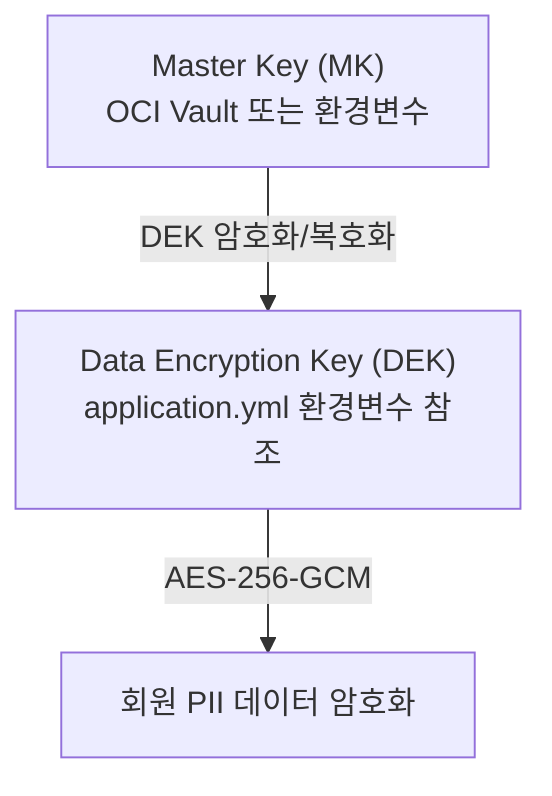
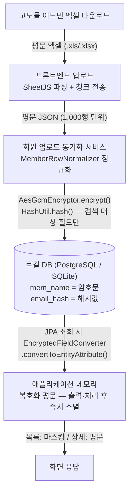

# 고도몰 회원 개인정보 암호화 설계

> 관련 문서: `godomall-member-fields.md`, `godomall-member-table.md`, `godomall-member-field-mapping.md`
> 작성일: 2026-06-10 / 최종 수정: 2026-06-11
> **확정 사항 (2026-06-11):** ① `business_no`는 암호화하지 않음 (평문 저장)
> ② 화면 표시는 목록 마스킹 / 상세 평문 — 암호화는 **저장 시점(at rest)** 보호 목적
> ③ 컬럼 정리로 `address_sub`, `last_login_ip`, `com_address_sub` 암호화 대상에서 제외 (컬럼 제거 — 테이블 정의 문서 7장)

---

## 1. 설계 목적

고도몰에서 동기화한 회원 데이터 중 개인정보 보호법(제29조) 대상 필드를 로컬 DB에 저장 시  
**암호화 처리**하여 DB 직접 접근·유출 상황에서도 개인정보가 노출되지 않도록 한다.

---

## 2. 암호화 대상 필드

### 2-1. godo_member

| 컬럼 | 원본 예시 | 암호화 방식 | 검색용 해시 컬럼 |
|------|----------|------------|----------------|
| `mem_name` | 홍길동 | AES-256-GCM | `mem_name_hash` |
| `email` | hong@example.com | AES-256-GCM | `email_hash` |
| `cell_phone` | 010-1234-5678 | AES-256-GCM | `cell_phone_hash` (하이픈 제거 후 해시) |
| `phone` | 02-123-4567 | AES-256-GCM | — |
| `birth_dt` | 1985-05-10 | AES-256-GCM | — |
| `address` | 06000 서울시 강남구 … 101호 | AES-256-GCM | 우편번호 포함 전체 주소 단일 저장 |

### 2-2. godo_member_business

| 컬럼 | 암호화 방식 | 비고 |
|------|------------|------|
| `ceo_name` | AES-256-GCM | 대표자(자연인) 이름 |
| `com_address` | AES-256-GCM | 사업장 주소 (우편번호 포함 전체) |

> ~~`business_no`(사업자번호)는 … 암호화 여부를 팀 내 별도 협의 필요.~~
> → **확정 (2026-06-11): 암호화하지 않음.** 평문 저장하며 `idx_godo_member_business_business_no` 인덱스로 직접 검색 가능.

---

## 3. 암호화 알고리즘

### 선택: AES-256-GCM

| 항목 | 내용 |
|------|------|
| 알고리즘 | AES (Advanced Encryption Standard) |
| 키 길이 | 256 bit (32 bytes) |
| 운영 모드 | GCM (Galois/Counter Mode) |
| IV (Nonce) | 96 bit (12 bytes), 암호화 시마다 랜덤 생성 |
| 인증 태그 | 128 bit (16 bytes) |
| 인코딩 | Base64 (URL-safe) |

**GCM 선택 이유:**
- 암호화(기밀성) + 인증(무결성)을 동시에 제공
- 동일 평문이라도 IV가 달라 매번 다른 암호문 생성 → 패턴 분석 방어
- JDK 표준 라이브러리(`javax.crypto`)로 외부 의존성 없이 구현 가능

### DB 저장 형식

```
Base64( IV(12 bytes) || CipherText || AuthTag(16 bytes) )
```

예시 저장값 (실제 값 아님):
```
dGVzdC1pdi0xMjM0NTY3OA==.암호화된데이터+인증태그==
```

평문 최대 길이별 저장 크기 추정:

| 필드 | 평문 최대 | 암호화 후 (Base64) |
|------|----------|-------------------|
| 이름 (20자 한글) | ~60 bytes | ~120 bytes |
| 이메일 (100자) | ~100 bytes | ~176 bytes |
| 주소 (150자) | ~450 bytes (한글) | ~640 bytes |
| 생년월일 | 10 bytes | ~56 bytes |

→ 암호화 컬럼은 모두 `TEXT` 타입으로 정의 (길이 제한 없음)

---

## 4. 키 관리

### 4-1. 키 계층 구조



| 키 | 역할 | 저장 위치 |
|----|------|----------|
| Master Key | DEK를 암호화/복호화 | OCI Vault 또는 환경변수 |
| DEK | 회원 데이터 암호화 | `application.yml` 환경변수 참조 |

### 4-2. 개발/운영 환경별 키 관리

| 환경 | 키 관리 방식 |
|------|------------|
| local | `application-local.yml` 환경변수 (`ENC_KEY`) |
| prod | OCI Vault Secret 또는 OS 환경변수 주입 |

### 4-3. application.yml 설정 (안)

```yaml
app:
  encryption:
    key: ${ENC_KEY}            # Base64 인코딩된 256-bit 키
    algorithm: AES/GCM/NoPadding
    iv-length: 12              # bytes
    tag-length: 128            # bits
```

---

## 5. Java 구현 설계

### 5-1. 전체 구조

```
com.sfood.automation.common.security
├── EncryptionProperties.java       # @ConfigurationProperties
├── AesGcmEncryptor.java            # 암/복호화 핵심 로직
├── EncryptedFieldConverter.java    # JPA AttributeConverter
└── HashUtil.java                   # 검색용 SHA-256 해시
```

### 5-2. AesGcmEncryptor (핵심 컴포넌트)

**역할:** AES-256-GCM 암호화/복호화 수행

```java
// 인터페이스 설계 (구현 없음)
public interface AesGcmEncryptor {

    /**
     * 평문을 AES-256-GCM으로 암호화한다.
     * @param plainText 암호화할 평문 (null 허용 → null 반환)
     * @return Base64(IV || CipherText || AuthTag)
     */
    String encrypt(String plainText);

    /**
     * 암호문을 복호화한다.
     * @param cipherText Base64(IV || CipherText || AuthTag)
     * @return 복호화된 평문 (null 허용 → null 반환)
     */
    String decrypt(String cipherText);
}
```

**처리 흐름 (encrypt):**
```
1. SecureRandom으로 IV(12 bytes) 생성
2. SecretKeySpec(DEK, "AES") 생성
3. Cipher.getInstance("AES/GCM/NoPadding") 초기화
4. GCMParameterSpec(128, iv) 설정
5. plainText → byte[] 암호화
6. IV + CipherText + AuthTag 결합
7. Base64 인코딩 후 반환
```

**처리 흐름 (decrypt):**
```
1. Base64 디코딩
2. 앞 12 bytes → IV 추출
3. 나머지 → CipherText + AuthTag
4. Cipher 복호화 모드 초기화
5. 복호화 후 String 반환
```

### 5-3. EncryptedFieldConverter (JPA 연동)

**역할:** JPA Entity ↔ DB 저장 시 자동 암호화/복호화

```java
// 설계 (구현 없음)
@Converter
public class EncryptedFieldConverter implements AttributeConverter<String, String> {

    // @Autowired AesGcmEncryptor encryptor;

    @Override
    public String convertToDatabaseColumn(String plainText) {
        // encryptor.encrypt(plainText)
    }

    @Override
    public String convertToEntityAttribute(String cipherText) {
        // encryptor.decrypt(cipherText)
    }
}
```

**Entity 적용 예시:**
```java
// 설계 (구현 없음)
@Entity
@Table(name = "godo_member")
public class GodoMember {

    @Convert(converter = EncryptedFieldConverter.class)
    @Column(name = "mem_name")
    private String memName;

    @Convert(converter = EncryptedFieldConverter.class)
    @Column(name = "email")
    private String email;

    @Column(name = "email_hash")
    private String emailHash;  // 검색용, 암호화 안함

    // ...
}
```

### 5-4. HashUtil (검색용 단방향 해시)

**역할:** 검색이 필요한 필드(이름·이메일·휴대폰)를 SHA-256으로 해싱

```java
// 설계 (구현 없음)
public class HashUtil {

    /**
     * 검색용 단방향 해시를 생성한다.
     * Salt = 고정 애플리케이션 시크릿 (검색 일관성 보장을 위해 랜덤 salt 미사용)
     * @param value 해시할 원본 값
     * @return HEX(SHA-256(salt + value))
     */
    public static String hash(String value) {
        // MessageDigest.getInstance("SHA-256")
        // salt + value → digest → HEX 변환
    }
}
```

> **검색 일관성:** 동일 입력이 항상 동일 해시가 되어야 `WHERE email_hash = ?` 검색이 가능하므로  
> 랜덤 salt 대신 **고정 애플리케이션 salt** 사용.

---

## 6. 검색 처리 방식

암호화된 필드는 DB에서 직접 `LIKE` 검색이 불가하므로 아래 방식을 적용한다.

| 검색 유형 | 처리 방법 |
|----------|----------|
| 정확일치 (이메일·휴대폰·이름) | `WHERE email_hash = HashUtil.hash(입력값)` |
| 부분검색 (이름 포함) | 전체 조회 후 애플리케이션 레이어에서 복호화 후 필터링 (건수 적을 때 한정) |
| 범위검색 (생년월일) | 암호화 대상 → DB 범위 검색 불가 → 전체 조회 후 복호화 필터링 |

---

## 7. 데이터 흐름



---

## 8. 구현 시 주의사항

| 항목 | 내용 |
|------|------|
| IV 재사용 금지 | 동일 키 + 동일 IV 재사용은 GCM 보안 완전 붕괴 → `SecureRandom`으로 매번 신규 생성 |
| 키 노출 금지 | DEK를 코드·로그에 절대 출력하지 않음 |
| 로그 마스킹 | 복호화된 평문이 애플리케이션 로그에 출력되지 않도록 `@ToString.Exclude` 등 적용 |
| 암호화 예외 처리 | `encrypt/decrypt` 실패 시 원문 반환 금지 → 명시적 예외 발생 후 처리 |
| 키 교체 (Re-keying) | DEK 변경 시 전체 암호화 데이터 재암호화 배치 필요 → 별도 마이그레이션 설계 필요 |
| null 처리 | null 입력 시 null 반환 (빈 문자열 암호화 방지) |

---

## 9. 의존성 (pom.xml / build.gradle 추가 불필요)

AES-256-GCM 구현에 필요한 모든 클래스는 **JDK 표준 라이브러리**에 포함되어 있습니다.

```
javax.crypto.Cipher
javax.crypto.spec.GCMParameterSpec
javax.crypto.spec.SecretKeySpec
java.security.SecureRandom
java.security.MessageDigest
java.util.Base64
```

외부 라이브러리 추가 없이 구현 가능합니다.

---

## 10. 관련 문서

| 문서 | 경로 |
|------|------|
| 필드 정의 | `backend/docs/analysis/godomall-member-fields.md` |
| 필드 매핑 | `backend/docs/analysis/godomall-member-field-mapping.md` |
| 테이블 정의 (SQLite) | `backend/docs/analysis/godomall-member-table.md` |
| PostgreSQL DDL | `backend/src/main/resources/postgresql/schema-member-postgresql.sql` |
