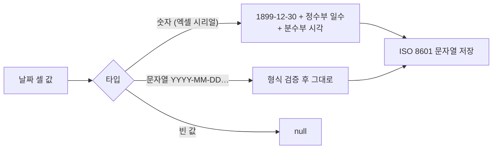
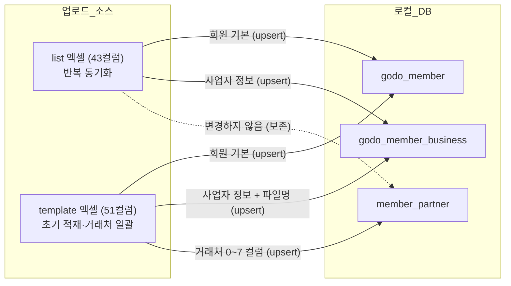

# 고도몰 회원 필드 매핑 정의

> 기준: `godomall-member-analysys-template.xlsx` ↔ 고도몰 API 필드명 (`godomall-member-fields.md`)
> 작성일: 2026-06-09 / 최종 수정: 2026-06-11 (실데이터 형식 검증·업로드 소스 정의 추가)
> **확정 사항 (2026-06-11):** 고도몰 회원 API는 제공되지 않음 → 데이터 유입은 **엑셀 업로드** 기준.
> 화면(DOM) 조회는 다운로드 엑셀보다 노출 항목이 적어 동기화 소스로 부적합.
> ⚠️ **초기 설계 기준 문서**: 아래 `service`/`item`/`duplicate_check` 컬럼명은 2026-06-11 시점의 초기 설계이며, 이후 실제 구현에서 `service`→`service_name`, `item`→`item_name`으로 변경되고 `service_code`/`item_code`(공통코드 매칭 결과) 컬럼이 추가되었으며, `duplicate_check`는 폐지되어 `member_status` 3단계로 통합되었다. 현재 계약은 `backend/docs/product/api-spec-member.md`, 현재 DDL은 `backend/docs/analysis/godomall-member-table.md` 참조.

---

## 1. 에쓰푸드몰 전용 컬럼 (고도몰 표준 외)

엑셀 템플릿에 존재하나 고도몰 표준 API 필드에 없는 에쓰푸드몰 자체 관리 컬럼입니다.

| 엑셀 컬럼명 | 설명 | 비고 |
|------------|------|------|
| `거래처등록` | 거래처 등록 여부 (`O` / 공란) | ERP/OMS 연동 여부 표시 |
| `거래처코드` | 거래처 식별 코드 (숫자, 예: 990954) | ERP/OMS 거래처 코드로 추정 |
| `거래처명` (1) | 거래처 전체명 (`(에쓰푸드몰)상호명` 형식) | 시스템 표기명 |
| `거래처명` (2) | 거래처 전체명 (동일 값 중복) | 중복 컬럼 |
| `세금계산서여부` | 세금계산서 발행 필요 여부 | `추가정보2(ex2)`와 연계 |
| `중복여부 확인` | 중복 회원 확인 결과 | 관리용 |
| `파일명` | 사업자등록증 첨부 파일명 | 어드민 `old_user_photo` 필드 대응 |

---

## 2. 전체 필드 매핑 테이블

| # | 엑셀 컬럼명 | 고도몰 API 필드명 | DB 컬럼명 (안) | 타입 | 비고 |
|---|------------|-----------------|--------------|------|------|
| 0 | 아이디 | `mem_id` | `mem_id` | VARCHAR(20) | Col 16과 동일 (중복) |
| 1 | 거래처등록 | _(없음)_ | `partner_registered_fl` | CHAR(1) | 에쓰푸드몰 전용 |
| 2 | 거래처코드 | _(없음)_ | `partner_code` | VARCHAR(20) | 에쓰푸드몰 전용, ERP 거래처 코드 |
| 3 | 거래처명 | _(없음)_ | `partner_name` | VARCHAR(100) | 에쓰푸드몰 전용 |
| 4 | 거래처명 (중복) | _(없음)_ | _(col 3과 동일)_ | — | 제거 대상 |
| 5 | 세금계산서여부 | `ex2` 연계 | `tax_invoice_fl` | CHAR(1) | 에쓰푸드몰 전용 |
| 6 | 중복여부 확인 | _(없음)_ | `duplicate_check` | VARCHAR(50) | 관리용 |
| 7 | 파일명 | `old_user_photo` | `biz_license_file` | VARCHAR(200) | 사업자등록증 파일 |
| 8 | 회원번호 | `mem_no` | `mem_no` | INTEGER PK | 고도몰 DB PK |
| 9 | 등록일 | `entry_dt` | `entry_dt` | DATETIME | Excel 시리얼 → YYYY-MM-DD 변환 필요 |
| 10 | 가입승인일 | _(별도 필드 없음)_ | `app_dt` | DATETIME | Excel 시리얼 → YYYY-MM-DD 변환 필요 |
| 11 | 가입승인여부 | `app_fl` | `app_fl` | CHAR(1) | `y`: 승인 / `n`: 미승인 |
| 12 | 가입경로 | `entry_path` | `entry_path` | VARCHAR(10) | `pc` / `mobile` |
| 13 | 최종로그인일 | `last_login_dt` | `last_login_dt` | DATETIME | |
| 14 | 회원구분 | `memberFl` | `member_fl` | VARCHAR(10) | `business` / `personal` |
| 15 | 등급 | `group_sno` | `group_sno` | INTEGER | 등급 코드 (1~9) |
| 16 | 아이디 | `mem_id` | `mem_id` | VARCHAR(20) | Col 0과 동일 (중복) |
| 17 | 닉네임 | `nick_name` | `nick_name` | VARCHAR(50) | |
| 18 | 이름 | `mem_name` | `mem_name` | VARCHAR(40) | |
| 19 | 이메일 | `email` | `email` | VARCHAR(100) | |
| 20 | 휴대폰번호 | `cell_phone` | `cell_phone` | VARCHAR(20) | 하이픈 포함 |
| 21 | 전화번호 | `phone` | `phone` | VARCHAR(20) | 하이픈 포함 |
| 22 | 주소 | `address` + `address_sub` | `address` | VARCHAR(250) | 주소+상세주소 합산 저장 |
| 23 | 메일수신여부 | `mailling_fl` | `mailling_fl` | CHAR(1) | `y` / `n` |
| 24 | SMS수신여부 | `sms_fl` | `sms_fl` | CHAR(1) | `y` / `n` |
| 25 | 주문금액 | `sale_amount` | `sale_amount` | DECIMAL(15,2) | |
| 26 | 마일리지 | `mileage` | `mileage` | DECIMAL(12,2) | 원본에 "점" 단위 포함 → 파싱 필요 |
| 27 | 예치금 | `deposit` | `deposit` | DECIMAL(12,2) | 원본에 "원" 단위 포함 → 파싱 필요 |
| 28 | 방문횟수 | `login_count` | `login_count` | INTEGER | |
| 29 | 상호 | `company` | `company` | VARCHAR(50) | |
| 30 | 사업자번호 | `business_no` | `business_no` | VARCHAR(15) | 하이픈 포함 형식 |
| 31 | 대표자명 | `ceo_name` | `ceo_name` | VARCHAR(20) | |
| 32 | 업태 | `service` | `service` | VARCHAR(30) | |
| 33 | 종목 | `item` | `item` | VARCHAR(30) | |
| 34 | 사업자 주소 | `com_address` + `com_address_sub` | `com_address` | VARCHAR(250) | 주소+상세주소 합산 저장 |
| 35 | 팩스 번호 | `fax` | `fax` | VARCHAR(20) | |
| 36 | 추천인아이디 | `recomm_id` | `recomm_id` | VARCHAR(20) | |
| 37 | 성별 | `sex_fl` | `sex_fl` | CHAR(1) | `m`: 남 / `w`: 여 |
| 38 | 생일 | `birth_dt` | `birth_dt` | DATE | Excel 시리얼 → YYYY-MM-DD 변환 필요 |
| 39 | 결혼여부 | `marri_fl` | `marri_fl` | CHAR(1) | `n`: 미혼 / `y`: 기혼 |
| 40 | 결혼기념일 | `marri_date` | `marri_date` | DATE | |
| 41 | 직업 | `job` | `job` | VARCHAR(10) | 직업 코드 |
| 42 | 관심분야 | `interest` | `interest` | VARCHAR(200) | 다중 값 `\|` 구분자 |
| 43 | 개인정보유효기간 | `expiration_fl` | `expiration_fl` | INTEGER | `1` / `3` / `5` / `999` |
| 44 | 남기는말씀 | `memo` | `memo` | VARCHAR(255) | |
| 45 | 추가정보1 | `ex1` | `ex1` | VARCHAR(100) | 업종 |
| 46 | 추가정보2 | `ex2` | `ex2` | VARCHAR(100) | 세금계산서 발행 여부 |
| 47 | 추가정보3 | `ex3` | `ex3` | VARCHAR(100) | 담당자 |
| 48 | 추가정보4 | `ex4` | `ex4` | VARCHAR(100) | 미사용 |
| 49 | 추가정보5 | `ex5` | `ex5` | VARCHAR(100) | 미사용 |
| 50 | 추가정보6 | `ex6` | `ex6` | VARCHAR(100) | 미사용 |

---

## 3. 데이터 변환 규칙

### 날짜 필드 (Excel 시리얼 → 날짜)

엑셀에서 날짜가 시리얼 숫자(예: `46169.42791`)로 저장된 경우 변환이 필요합니다.

| 엑셀 컬럼 | DB 컬럼 | 변환 방법 |
|----------|--------|----------|
| 등록일 | `entry_dt` | `LocalDate.of(1899,12,30).plusDays((long)serial)` |
| 가입승인일 | `app_dt` | 동일 |
| 생일 | `birth_dt` | 동일 (날짜만, 시간 제외) |

### 단위 포함 필드 (문자열 → 숫자)

| 엑셀 컬럼 | 원본 형식 | 변환 방법 |
|----------|---------|----------|
| 마일리지 | `0점` | "점" 제거 후 숫자 파싱 |
| 예치금 | `0원` | "원" 제거 후 숫자 파싱 |

### 플래그 변환

| 엑셀 값 | DB 값 | 해당 컬럼 |
|--------|------|----------|
| `미승인` | `n` | `app_fl` |
| `승인` | `y` | `app_fl` |
| `O` | `y` | `partner_registered_fl` |
| (공란) | `n` | `partner_registered_fl` |

### 추가 정규화 규칙 (2026-06-11 실데이터 검증으로 확인)

| 항목 | 원본 형식 | 규칙 |
|------|----------|------|
| 거래처코드 | 엑셀 **숫자 셀** (예: 990954) | 정수 문자열로 변환 (`"990954.0"` 부동소수점 문자열화 금지) |
| 회원번호 | 엑셀 숫자 셀 | 정수 변환 |
| 주소·사업자 주소 | `"06000 서울시 강남구 … 101호"` — **선행 5자리 우편번호 포함 단일 문자열** | 분리하지 않고 전체 문자열 그대로 암호화 저장 (zonecode 컬럼 미사용 — 테이블 정의 문서 7장 참조) |
| 휴대폰·전화·사업자번호 | 하이픈 포함 문자열 | 저장은 원본 그대로. **검색 해시 생성 시에만** 하이픈 제거 후 해시 (검색 입력도 동일 정규화) |
| 메일/SMS 수신여부 | `y` / `n` 단일 문자 (한글 아님) | 변환 없이 그대로 저장 |
| 빈 셀 | 셀 자체 누락 | null 저장 (빈 문자열 금지 — 암호화 모듈 null 규칙과 일치) |
| 제로 날짜 | `0000-00-00`, `0000-00-00 00:00:00` 문자열 (MySQL 제로 날짜 — 2026-06-12 실측) | null 저장 (모든 날짜 컬럼 공통) |

---

## 4. 실데이터 형식 검증 결과 (2026-06-11)

`godomall-member-analysys-template.xlsx`와 `godomall-member-list.xlsx`(고도몰 다운로드 원본의 xlsx 저장본)
실데이터를 패턴 분석(개인정보 마스킹)하여 셀 타입을 확정했다. 컬럼 번호는 template 기준(괄호는 list 기준).

| 컬럼 | 엑셀 셀 타입 | 실측 형식 | 변환 |
|------|------------|----------|------|
| 등록일(9/1) / 가입승인일(10/2) | 숫자 (시리얼) | `46169.42791…` — **시간 분수부 포함** | 시리얼 → `YYYY-MM-DD HH:MM:SS` |
| 최종로그인일(13/5) | **혼재** | 문자열 `YYYY-MM-DD HH:MM:SS` **또는** 시리얼 숫자 — **같은 컬럼에 행마다 다른 타입** | 타입 분기 처리 (아래 '날짜 타입 혼재' 참조) |
| 생일(38/30) | **혼재** | 시리얼 숫자 **또는** 문자열 `YYYY-MM-DD` | 타입 분기 처리 |
| 결혼기념일(40/32) | 문자열 | `YYYY-MM-DD` | 그대로 저장 (방어적으로 타입 분기 적용) |
| 마일리지(26/18) / 예치금(27/19) | 문자열 | `0점`, `1500점` / `0원` — 천 단위 값 확인 | 단위·비숫자 문자 제거 후 숫자 (쉼표 방어 포함) |
| 주문금액(25/17) / 방문횟수(28/20) | 숫자 | 숫자 | 그대로 |
| 회원구분(14/6) | 문자열 | `business` / `personal` | 그대로 |
| 등급(15/7) / 개인정보유효기간(43/35) | 숫자 | 한 자리 정수 | 그대로 |
| 사업자번호(30/22) | 문자열 | `XXX-XX-XXXXX` | 그대로 (평문 저장 — 암호화 제외 확정) |
| 거래처등록(1/—) | 문자열 | `O` 단일 문자 | `y`/`n` 플래그 (template 전용) |
| 가입승인여부(11/3) | 문자열 | `미승인` / `승인` (한글) | `n`/`y` 플래그 (양쪽 값 모두 실측 확인) |
| 이름·이메일·휴대폰·주소 | 문자열 | **빈 셀인 행 존재 실측** (사업자 정보만 있는 회원) | null 허용 필수 |

### 날짜 타입 혼재 — 정규화 핵심 규칙

list 실데이터에서 **동일 날짜 컬럼이 행에 따라 시리얼 숫자 또는 문자열로 섞여** 들어오는 것이 확인됐다
(최종로그인일·생일에서 실측, 전 날짜 컬럼에 방어 적용).
`MemberRowNormalizer`는 모든 날짜 필드에 대해 아래 분기를 공통 적용한다.



---

## 5. 업로드 소스 파일 정의

데이터 유입 경로는 엑셀 업로드 2종이다. **데이터 모델(화면·테이블)은 template 기준**, **반복 동기화는 list 파일 기준**으로 한다.

### 5-1. 고도몰 회원 리스트 파일 — 반복 동기화용 ✅ 컬럼 검증 완료 (2026-06-11)

| 항목 | 내용 |
|------|------|
| 출처 | 고도몰 어드민 회원 메뉴 > 엑셀 다운로드 |
| 원본 형식 | 확장자 `.xls`, 실체는 **HTML 문서** (페이지 제목 "Excel Down") — 바이너리 XLS 아님 |
| 저장소 보관본 | `godomall-member-list.xlsx` — 원본을 Excel에서 ".xlsx로 다른 이름 저장"한 검증용 사본 |
| 파서 | SheetJS(`xlsx` 라이브러리)는 HTML 테이블·xlsx 모두 자동 인식 → 기존 상품 업로드(`ExcelUploadModal`)와 동일하게 프론트엔드 파싱 |
| **컬럼 구성** | **43개 컬럼 (0~42) = template의 8~50번 컬럼과 명칭·순서 완전 일치 확인** (`list[n] = template[n+8]`) |
| **upsert 키** | **회원번호(`mem_no`) 포함 확인** → mem_no 기준 upsert 확정 |
| 적재 대상 | `godo_member`, `godo_member_business` (upsert) — `member_partner`는 건드리지 않음 |

**list 파일 컬럼 (실측 헤더, 0~42):**

```
회원번호, 등록일, 가입승인일, 가입승인여부, 가입경로, 최종로그인일, 회원구분, 등급,
아이디, 닉네임, 이름, 이메일, 휴대폰번호, 전화번호, 주소, 메일수신여부, SMS수신여부,
주문금액, 마일리지, 예치금, 방문횟수, 상호, 사업자번호, 대표자명, 업태, 종목,
사업자 주소, 팩스 번호, 추천인아이디, 성별, 생일, 결혼여부, 결혼기념일, 직업,
관심분야, 개인정보유효기간, 남기는말씀, 추가정보1~6
```

> **⚠️ 주의 — Excel "웹 페이지로 저장" 금지:** 다운로드 파일을 Excel에서 열어 같은 형식(웹 페이지)으로
> 다시 저장하면 프레임셋 + 별도 폴더(`*.files/sheet001.htm`) 구조로 분리되어 본 파일에서 데이터가 사라진다.
> 업로드는 **다운로드 원본 그대로** 또는 **".xlsx로 다른 이름 저장"본**만 사용한다.

### 5-2. 분석 템플릿 파일 (`godomall-member-analysys-template.xlsx`) — 초기 적재·거래처 정보용

| 항목 | 내용 |
|------|------|
| 출처 | list 파일을 담당자가 정리·보강한 관리 파일 (거래처코드 등 0~7번 컬럼 추가) |
| 형식 | 표준 xlsx (Excel 2007+) |
| 컬럼 구성 | 0~50번 전체 (2장 매핑 테이블) |
| 적재 대상 | `godo_member`, `godo_member_business`, **`member_partner`** (3개 테이블 전체) |
| 용도 | 최초 1회 초기 적재 + 거래처 매핑 정보 일괄 갱신 |

### 5-3. 소스별 컬럼 → 테이블 적재 구분

| 컬럼 범위 (template 기준) | list 파일 | template 파일 | 적재 테이블 |
|----------|:---:|:---:|------------|
| 0~7 (거래처·관리 컬럼) | ✗ | ✓ | `member_partner` (+ 파일명 → `godo_member_business.biz_license_file`) |
| 8~28, 36~50 (회원 기본) | ✓ (list 0~20, 28~42) | ✓ | `godo_member` |
| 29~35 (사업자 정보) | ✓ (list 21~27) | ✓ | `godo_member_business` |


