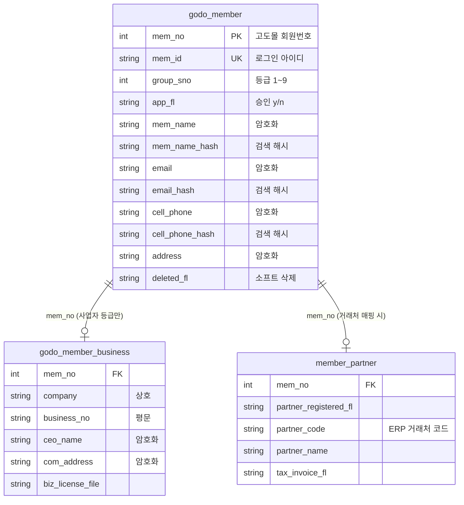

# 고도몰 회원 테이블 정의

> 기준: `godomall-member-field-mapping.md` + 프로젝트 SQLite 스키마 컨벤션
> 작성일: 2026-06-09 / 최종 수정: 2026-07-10 (3-2·3-3 DDL을 실제 스키마(`schema.sql`)에 맞춰 갱신 — 업태/업종 컬럼명 변경, `member_partner` 상태 통합 반영)

---

## 1. 테이블 설계 방침

- 고도몰 회원 데이터는 **읽기 전용 스냅샷** 목적으로 로컬 DB에 저장
- 에쓰푸드몰 전용 거래처 정보는 **별도 테이블(`member_partner`)** 로 분리
- 날짜 타입: 프로젝트 컨벤션에 따라 `TEXT` (ISO 8601 형식)
- PK: 고도몰 `mem_no` 를 자연키로 사용 (별도 `id` 추가)
- **데이터 유입은 엑셀 업로드 전용** (고도몰 회원 API 미제공 확정, 2026-06-11) —
  업로드 소스(엑셀)에 존재하지 않는 고도몰 표준 컬럼은 보유하지 않는다 (7장 검토 이력)
- PII(개인식별정보) 컬럼은 AES-256-GCM 암호화 저장 + 검색 대상 필드는 SHA-256 해시 컬럼 병행

---

## 2. 테이블 목록

| 테이블명 | 설명 |
|---------|------|
| `godo_member` | 고도몰 회원 기본 정보 |
| `godo_member_business` | 사업자 정보 (사업자회원·B2B 거래처 해당) |
| `member_partner` | 에쓰푸드몰 거래처 매핑 정보 |

---

## 3. DDL 정의 (SQLite)

### 3-1. godo_member

```sql
CREATE TABLE IF NOT EXISTS godo_member (
    -- 식별자
    id              INTEGER PRIMARY KEY AUTOINCREMENT,
    mem_no          BIGINT  NOT NULL UNIQUE,        -- 고도몰 회원 번호 (엑셀: 회원번호) — upsert 키
    mem_id          TEXT    NOT NULL UNIQUE,        -- 로그인 아이디 (엑셀: 아이디)

    -- 등급·승인
    group_sno       INTEGER NOT NULL DEFAULT 1,     -- 회원 등급 코드 1~9 (엑셀: 등급)
    member_fl       TEXT    NOT NULL DEFAULT 'personal', -- personal / business (엑셀: 회원구분)
    app_fl          TEXT    NOT NULL DEFAULT 'n',   -- 가입 승인 y / n (엑셀: 가입승인여부)
    app_dt          TEXT,                           -- 가입 승인일 (엑셀: 가입승인일, 시리얼 변환)

    -- 기본 정보 [암호화: mem_name, birth_dt]
    mem_name        TEXT,                           -- 이름 (AES-256-GCM 암호화)
    mem_name_hash   TEXT,                           -- 이름 검색용 SHA-256 해시
    nick_name       TEXT,                           -- 닉네임
    sex_fl          TEXT,                           -- 성별: m / w
    birth_dt        TEXT,                           -- 생년월일 (AES-256-GCM 암호화, 시리얼 변환)
    marri_fl        TEXT,                           -- 결혼 여부: y / n
    marri_date      TEXT,                           -- 결혼기념일 (YYYY-MM-DD)
    job             TEXT,                           -- 직업 코드
    interest        TEXT,                           -- 관심분야 코드 ('|' 구분자)

    -- 연락처 [암호화: email, cell_phone, phone]
    email           TEXT,                           -- 이메일 (AES-256-GCM 암호화)
    email_hash      TEXT,                           -- 이메일 검색용 SHA-256 해시
    cell_phone      TEXT,                           -- 휴대폰 (AES-256-GCM 암호화)
    cell_phone_hash TEXT,                           -- 휴대폰 검색용 SHA-256 해시 (하이픈 제거 후 해시)
    phone           TEXT,                           -- 전화번호 (AES-256-GCM 암호화)
    fax             TEXT,                           -- 팩스번호
    mailling_fl     TEXT    NOT NULL DEFAULT 'y',   -- 메일 수신 동의: y / n
    sms_fl          TEXT    NOT NULL DEFAULT 'y',   -- SMS 수신 동의: y / n

    -- 주소 [암호화] — 엑셀 원본이 우편번호 포함 단일 문자열이므로 분리 없이 통째 저장
    address         TEXT,                           -- 주소 전체 (AES-256-GCM 암호화)

    -- 활동·통계
    entry_dt        TEXT,                           -- 회원가입일 (엑셀: 등록일, 시리얼 변환)
    entry_path      TEXT    NOT NULL DEFAULT 'pc',  -- 가입경로: pc / mobile
    last_login_dt   TEXT,                           -- 최종 로그인일 (엑셀: 문자열 그대로)
    login_count     INTEGER NOT NULL DEFAULT 0,     -- 방문횟수
    sale_amount     DOUBLE  NOT NULL DEFAULT 0,     -- 주문금액
    mileage         DOUBLE  NOT NULL DEFAULT 0,     -- 마일리지 ("0점" 단위 제거)
    deposit         DOUBLE  NOT NULL DEFAULT 0,     -- 예치금 ("0원" 단위 제거)

    -- 추천인
    recomm_id       TEXT,                           -- 추천인 아이디

    -- 추가 정보
    ex1             TEXT,                           -- 추가1: 업종
    ex2             TEXT,                           -- 추가2: 세금계산서 발행 여부
    ex3             TEXT,                           -- 추가3: 담당자
    ex4             TEXT,
    ex5             TEXT,
    ex6             TEXT,

    -- 개인정보
    expiration_fl   INTEGER NOT NULL DEFAULT 1,     -- 개인정보유효기간 1/3/5/999

    -- 기타
    memo            TEXT,                           -- 남기는말씀

    -- 시스템
    deleted_fl      TEXT NOT NULL DEFAULT 'n',      -- 소프트 삭제 (전체 동기화 시 미수신 회원 'y')
    synced_at       TEXT NOT NULL,                  -- 마지막 동기화(업로드 반영) 시각
    created_at      TEXT NOT NULL,
    updated_at      TEXT NOT NULL
);

CREATE UNIQUE INDEX IF NOT EXISTS uk_godo_member_mem_no ON godo_member(mem_no);
CREATE UNIQUE INDEX IF NOT EXISTS uk_godo_member_mem_id ON godo_member(mem_id);
CREATE INDEX IF NOT EXISTS idx_godo_member_group_sno       ON godo_member(group_sno);
CREATE INDEX IF NOT EXISTS idx_godo_member_app_fl          ON godo_member(app_fl);
CREATE INDEX IF NOT EXISTS idx_godo_member_member_fl       ON godo_member(member_fl);
CREATE INDEX IF NOT EXISTS idx_godo_member_entry_dt        ON godo_member(entry_dt);
CREATE INDEX IF NOT EXISTS idx_godo_member_deleted_fl      ON godo_member(deleted_fl);
CREATE INDEX IF NOT EXISTS idx_godo_member_mem_name_hash   ON godo_member(mem_name_hash);
CREATE INDEX IF NOT EXISTS idx_godo_member_email_hash      ON godo_member(email_hash);
CREATE INDEX IF NOT EXISTS idx_godo_member_cell_phone_hash ON godo_member(cell_phone_hash);
```

### 3-2. godo_member_business

```sql
CREATE TABLE IF NOT EXISTS godo_member_business (
    id              INTEGER PRIMARY KEY AUTOINCREMENT,
    mem_no          BIGINT  NOT NULL UNIQUE,        -- godo_member.mem_no FK

    -- 사업자 정보
    company         TEXT,                           -- 상호
    business_no     TEXT,                           -- 사업자번호 XXX-XX-XXXXX (평문 — 암호화 제외 확정)
    ceo_name        TEXT,                           -- 대표자명 (AES-256-GCM 암호화)
    service_name    TEXT,                           -- 업태명 (엑셀 원본 텍스트). 2026-07-06 이전 컬럼명: service
    item_name       TEXT,                           -- 업종명 (엑셀 원본 텍스트). 2026-07-06 이전 컬럼명: item
    service_code    TEXT,                           -- 업태 공통코드(그룹코드 SERVICE) — service_name을 common_code에 매칭해 자동 채움. 매칭 실패 시 null
    item_code       TEXT,                           -- 업종 공통코드(그룹코드 ITEM) — item_name을 common_code에 매칭해 자동 채움. 매칭 실패 시 null
    duplicate_mem_no TEXT,                          -- 동일 business_no를 가진 다른 활성 회원의 mem_no 목록(`;` 구분). 중복 없으면 null

    -- 사업장 주소 [암호화] — 우편번호 포함 단일 문자열 통째 저장
    com_address     TEXT,                           -- 사업장 주소 전체 (AES-256-GCM 암호화)

    -- 사업자등록증
    biz_license_file TEXT,                          -- 사업자등록증 파일명 (template: 파일명)

    -- 시스템
    created_at      TEXT NOT NULL,
    updated_at      TEXT NOT NULL,

    FOREIGN KEY (mem_no) REFERENCES godo_member(mem_no)
);

CREATE UNIQUE INDEX IF NOT EXISTS uk_godo_member_business_mem_no
    ON godo_member_business(mem_no);
CREATE INDEX IF NOT EXISTS idx_godo_member_business_business_no
    ON godo_member_business(business_no);
```

### 3-3. member_partner

```sql
CREATE TABLE IF NOT EXISTS member_partner (
    id                    INTEGER PRIMARY KEY AUTOINCREMENT,
    mem_no                BIGINT  NOT NULL UNIQUE,  -- godo_member.mem_no FK

    -- 에쓰푸드몰 거래처 정보
    partner_code          TEXT,                      -- 거래처 코드 (ERP 연동 코드)
    partner_name          TEXT,                      -- 거래처명
    tax_invoice_fl        TEXT NOT NULL DEFAULT 'n', -- 세금계산서 발행 여부: y / n
    member_status         TEXT NOT NULL DEFAULT 'NORMAL', -- 거래처 상태: UNREGISTERED / NORMAL / INACTIVE

    -- 시스템
    created_at            TEXT NOT NULL,
    updated_at            TEXT NOT NULL,

    FOREIGN KEY (mem_no) REFERENCES godo_member(mem_no)
);

CREATE UNIQUE INDEX IF NOT EXISTS uk_member_partner_mem_no
    ON member_partner(mem_no);
CREATE INDEX IF NOT EXISTS idx_member_partner_partner_code
    ON member_partner(partner_code);
CREATE INDEX IF NOT EXISTS idx_member_partner_member_status
    ON member_partner(member_status);
```

> **2026-07-03 스키마 변경(`b002c32`)**: `partner_registered_fl`, `duplicate_check` 컬럼은 폐지되었다. 거래처 등록 여부와 중복 확인 상태는 `member_status`(`UNREGISTERED`/`NORMAL`/`INACTIVE`) 3단계로 통합 관리한다. 두 컬럼을 참조하는 하위 시스템/문서가 남아 있다면 갱신이 필요하다.

---

## 4. 등급 코드 참조 (group_sno)

| group_sno | 등급명 | 사업자 정보 여부 |
|-----------|--------|----------------|
| 1 | 일반회원 | X |
| 2 | 사업자회원_화이트 | O |
| 3 | 사업자회원_로제 | O |
| 5 | 사업자회원_레드 | O |
| 6 | 사업자회원_VIP | O |
| 7 | 관리자 등급 | X |
| 8 | 기능장회원 | X |
| 9 | B2B 거래처 | O |

사업자 정보 여부(`O`)인 경우 `godo_member_business` 레코드가 함께 존재합니다.

---

## 5. 엔티티 관계도 (ERD)



---

## 6. 주요 조회 패턴

```sql
-- B2B 거래처 전체 조회 (거래처 정보 포함)
SELECT m.mem_no, m.mem_id, m.mem_name, m.cell_phone, m.email,
       b.company, b.business_no,
       p.partner_code, p.partner_name
FROM godo_member m
LEFT JOIN godo_member_business b ON m.mem_no = b.mem_no
LEFT JOIN member_partner p       ON m.mem_no = p.mem_no
WHERE m.group_sno = 9;

-- 사업자회원 전체 (등급 2,3,5,6,9)
SELECT * FROM godo_member
WHERE group_sno IN (2, 3, 5, 6, 9)
  AND app_fl = 'y';

-- 거래처 코드로 회원 조회
SELECT m.*, p.partner_code, p.partner_name
FROM godo_member m
JOIN member_partner p ON m.mem_no = p.mem_no
WHERE p.partner_code = ?;
```

> PII 컬럼(mem_name, email, cell_phone, phone, birth_dt, address, ceo_name, com_address)은
> 암호문이 조회되므로 애플리케이션 레이어에서 복호화한다. 이름·이메일·휴대폰 검색은 `*_hash` 컬럼으로 수행한다.

---

## 7. 컬럼 검토 이력 (2026-06-11) — 업로드 소스 기준 정합화

고도몰 회원 API 미제공이 확정되어 데이터 유입이 **엑셀 업로드 전용**이 되었다.
업로드 소스(list/template 엑셀)에 존재하지 않아 영구히 null/기본값으로 남을 컬럼을 제거하고,
암호화 설계·소프트 삭제 정책에 필요한 컬럼을 추가했다.

### 7-1. 제거 컬럼 (소스 없음 — 고도몰 API 전용 필드)

| 테이블 | 컬럼 | 제거 사유 |
|--------|------|----------|
| godo_member | `calendar_fl` | 양음력 — 엑셀에 없음 |
| godo_member | `zonecode`, `address_sub` | 엑셀 주소가 우편번호 포함 단일 문자열 → `address` 통합 저장 |
| godo_member | `last_login_ip` | 엑셀에 없음 + PII 암호화 관리 부담만 발생 |
| godo_member | `last_sale_dt`, `sale_count` | 엑셀에 없음 (주문금액 `sale_amount`만 존재) |
| godo_member | `recomm_fl` | 엑셀에 없음 (`recomm_id` 존재 여부로 대체 가능) |
| godo_member | `private_approval_fl` 외 동의 플래그 4종 | 엑셀에 없음 |
| godo_member | `admin_memo`, `re_entry_fl` | 엑셀에 없음 (고도몰 어드민 내부 전용) |
| godo_member_business | `com_zonecode`, `com_address_sub` | 사업장 주소 단일 문자열 → `com_address` 통합 저장 |

### 7-2. 추가 컬럼

| 테이블 | 컬럼 | 추가 사유 |
|--------|------|----------|
| godo_member | `mem_name_hash`, `email_hash`, `cell_phone_hash` | 암호화 필드 검색용 SHA-256 해시 (암호화 설계 문서 5-4) — 기존 SQLite DDL 누락 보정 |
| godo_member | `deleted_fl` | 전체 동기화 시 미수신 회원 소프트 삭제 (계획서 정책 2-1) — 기존 DDL 누락 보정 |

### 7-3. 변경 컬럼

| 테이블 | 컬럼 | 변경 내용 |
|--------|------|----------|
| godo_member | `marri_fl` | `NOT NULL DEFAULT 'n'` → null 허용 (엑셀 빈 셀 = 미입력과 '미혼' 구분) |
| godo_member_business | `business_no` | **암호화 제외 확정** (2026-06-11 결정) — 평문 저장, 기존 인덱스 유지 |

### 7-4. 데이터 보존 원칙 (업로드 종류별)

| 업로드 종류 | godo_member / godo_member_business | member_partner |
|------------|-----------------------------------|----------------|
| list 파일 (반복 동기화) | mem_no 기준 upsert + 미수신 회원 `deleted_fl='y'` | **변경하지 않음** (수동 관리 데이터 보존) |
| template 파일 (초기·일괄) | mem_no 기준 upsert | upsert (거래처 정보 갱신) |
