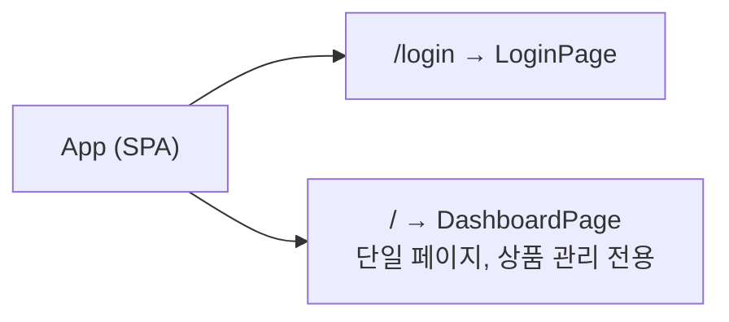
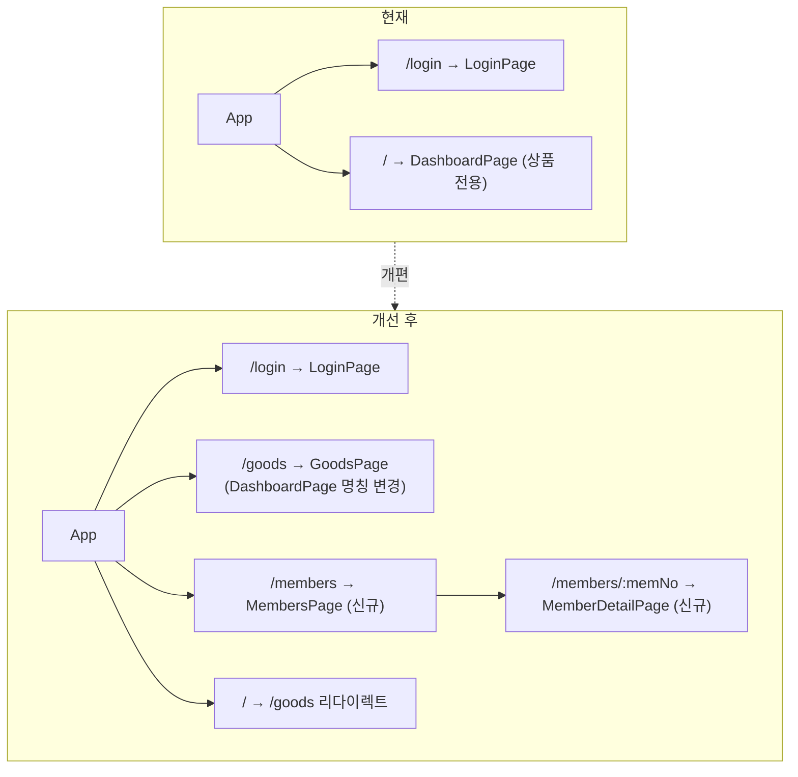
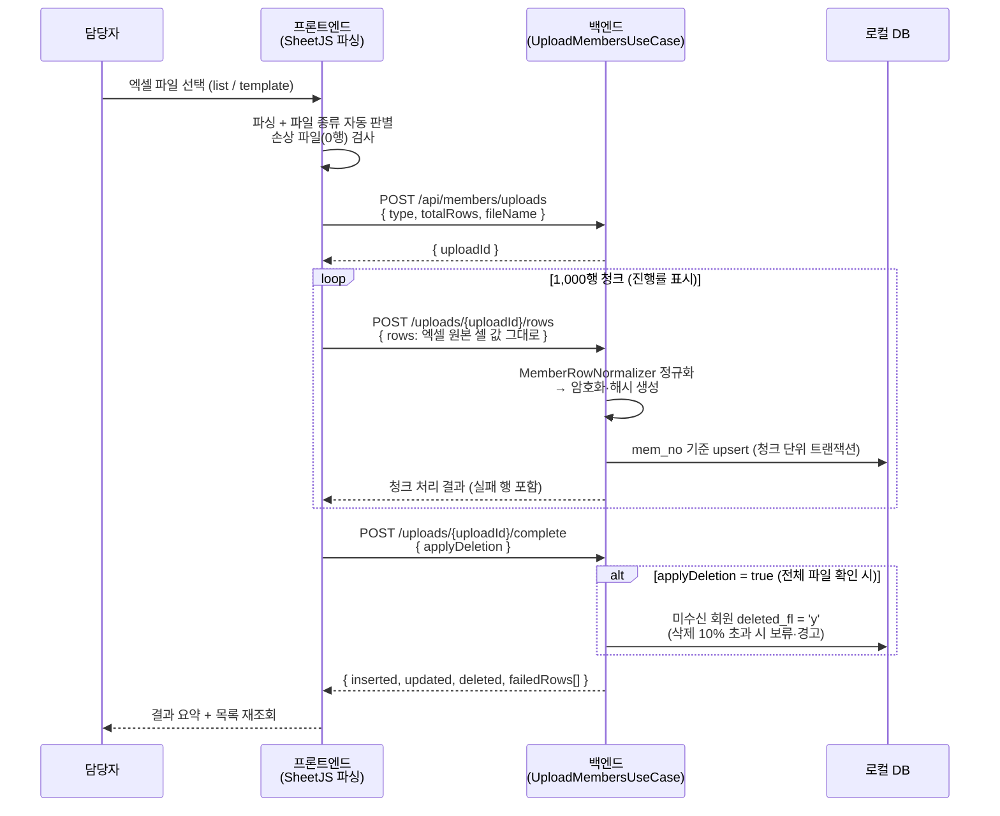

# 회원 관리 기능 추가 및 UI 개선 계획서

> 상태: 확정 (2026-06-10 논의 완료) · 구현 계획 보강 (2026-06-11) · **동기화 방식 확정: 엑셀 업로드 (2026-06-11)**
> 작성일: 2026-06-10 / 최종 수정: 2026-06-11
> 관련 문서: `godomall-member-fields.md`, `godomall-member-table.md`, `godomall-member-encryption-design.md`
>
> **2026-06-11 확정 사항 (실데이터 분석 후):**
> - 고도몰 회원 API 미제공 + 화면(DOM) 조회는 노출 항목 부족 → **동기화 = 엑셀 다운로드 후 업로드** 방식 확정
> - `business_no` 암호화 제외 (평문 저장)
> - 상세 화면 **평문 표시** 확정 (암호화는 저장 시점 보호 목적, 목록은 마스킹 유지)
> - 테이블 컬럼을 업로드 소스 기준으로 정합화 (`godomall-member-table.md` 7장 검토 이력)

---

## 1. 현황 분석

### 1-1. 현재 서비스 구조



**현재 DashboardPage 구성 (상품 중심)**

| 섹션 | 역할 |
|------|------|
| Header | 배치 실행 상태, 알림 설정, 로그아웃 |
| SummaryCards | 품절 수, 오늘 변경 건수 요약 |
| HistoryTable | 상품 상태 변경 이력 (날짜 필터) |
| ProductTable | 전체 상품 목록 (검색·정렬·페이지) |

**현재 한계**
- 단일 페이지 구조로 확장에 한계
- 네비게이션(메뉴) 없음 — 기능 추가 시 페이지 전환 불가
- 회원 관련 화면 없음

### 1-2. 추가해야 할 기능

- 고도몰 회원 데이터 동기화 및 로컬 저장
- 회원 목록 조회·검색·필터
- B2B 거래처 회원 전용 관리 (파트너 코드 연동)
- 가입 승인 처리

---

## 2. 서비스 정책

### 2-1. 회원 데이터 동기화 정책 (2026-06-11 갱신 — 엑셀 업로드 확정)

| 항목 | 정책 |
|------|------|
| 동기화 방향 | 고도몰 → 로컬 DB (단방향, 읽기 전용 기준) |
| 동기화 방법 | **고도몰 어드민에서 회원 엑셀 다운로드 → 본 서비스에 업로드** (회원 API 미제공, 화면 조회는 노출 항목 부족으로 부적합 확정) |
| 동기화 주기 | 수동 (담당자 필요 시 업로드). 자동 스케줄은 소스가 없어 불가 — 어드민 세션 기반 다운로드 자동화는 Phase 3 검토 |
| 업로드 소스 | 반복 동기화: 고도몰 list 엑셀 / 초기 적재·거래처 일괄 갱신: 분석 template 엑셀 (필드 매핑 문서 5장) |
| 충돌 처리 | 고도몰 데이터 우선 (mem_no 기준 upsert 덮어쓰기). 단, `member_partner`는 list 업로드 시 보존 |
| 삭제 처리 | 전체 파일 업로드 시 미수신 회원 `deleted_fl = 'y'` 소프트 삭제 (부분 파일 오삭제 방지 가드 — 7-4 참조) |

### 2-2. 회원 관리 권한 정책

| 기능 | 정책 |
|------|------|
| 회원 목록 조회 | 로그인 사용자 전체 허용 |
| 회원 상세 조회 | 로그인 사용자 전체 허용 |
| 가입 승인 처리 | 로그인 사용자 전체 허용 (고도몰 어드민 API 호출) |
| 파트너 코드 수정 | 로그인 사용자 전체 허용 |
| 회원 정보 직접 수정 | **미지원** — 고도몰 어드민에서 수정 (링크 제공) |

### 2-3. 개인정보 보호 정책

| 항목 | 정책 |
|------|------|
| 저장 시 암호화 | 이름·이메일·전화번호·주소·생년월일·IP (AES-256-GCM) |
| 화면 표시 | 전화번호·이메일 마스킹 처리 (010-****-5678) — 상세 조회 시 해제 |
| 로그 기록 금지 | 복호화된 개인정보 로그 출력 금지 |
| 데이터 파기 | 탈퇴 회원 동기화 시 암호화 필드 파기 처리 |

### 2-4. B2B 거래처 관리 정책

| 항목 | 정책 |
|------|------|
| 거래처 식별 | 고도몰 `group_sno = 9` (B2B 거래처 등급) |
| 파트너 코드 | ERP 거래처 코드와 수동 매핑 (`member_partner.partner_code`) |
| 표시 방식 | 회원 목록에서 배지(badge)로 B2B 구분 표시 |

---

## 3. 네비게이션 구조 개선안 ✅ 확정

### 결정 사항
- **네비게이션**: 상단 탭 (Option B) — Header 구조 유지, 변경 범위 최소화
- **회원 상세**: 별도 페이지 — 정보량이 많아 모달보다 페이지가 적합
- **서비스 방향**: 상품 자동화 기반에 회원 관리 추가 — 향후 도메인 확장 계획 없음

### 현재 → 개선 후 라우팅



### 레이아웃 구조

```
┌──────────────────────────────────────────────────┐
│  Logo  [배치 상태]  ·····················  [사용자] │  ← Header (현재와 동일)
├──────────────────────────────────────────────────┤
│  [ 상품 관리 ]  [ 회원 관리 ]                      │  ← TabBar 컴포넌트 (신규)
├──────────────────────────────────────────────────┤
│                                                  │
│                  콘텐츠 영역                      │
│                                                  │
└──────────────────────────────────────────────────┘
```

### TabBar 컴포넌트 설계 방침

- Header 바로 아래, `<main>` 위에 위치
- 활성 탭: `--teal` 하단 보더 + 텍스트 색상 강조
- config 배열 기반으로 탭 목록 관리 (탭 추가 시 배열 항목만 추가)
- 배치 상태(Header)는 상품 탭/회원 탭 무관하게 전역 표시 유지 — 현재 구조 그대로

```typescript
// TabBar 설정 예시 (설계 참고)
const TABS = [
  { label: '상품 관리', path: '/goods' },
  { label: '회원 관리', path: '/members' },
];
```

---

## 4. 회원 관리 화면 설계

### 4-1. 회원 목록 페이지 (`/members`)

**상단 요약 카드 (SummaryCards 회원 버전)**

| 카드 | 표시 내용 |
|------|----------|
| 전체 회원 | 총 회원 수 |
| 사업자 회원 | group_sno 2·3·5·6 합계 |
| B2B 거래처 | group_sno = 9 |
| 미승인 회원 | app_fl = 'n' |

**검색·필터 바**

| 항목 | 옵션 |
|------|------|
| 키워드 | 아이디 / 이름(해시) / 이메일(해시) / 휴대폰(해시) |
| 등급 | 전체 / 일반 / 사업자(전체) / B2B 거래처 |
| 승인 상태 | 전체 / 승인 / 미승인 |
| 가입 기간 | 날짜 범위 |

**회원 목록 테이블 컬럼**

| 컬럼 | 내용 | 비고 |
|------|------|------|
| 번호 | mem_no | |
| 아이디 | mem_id | |
| 이름 | mem_name | 마스킹 표시 |
| 등급 | group_sno → 뱃지 | B2B는 별도 색상 |
| 휴대폰 | cell_phone | 마스킹: 010-****-5678 |
| 상호 | company | 사업자만 표시 |
| 파트너 코드 | partner_code | B2B만 표시 |
| 가입일 | entry_dt | |
| 승인 | app_fl | 승인/미승인 뱃지 |
| 액션 | 상세보기 / 고도몰 이동 | |

### 4-2. 회원 상세 페이지 (`/members/:memNo`) ✅ 페이지로 확정

**표시 섹션**

```
┌─────────────────────────────────────────┐
│  기본 정보          │  사업자 정보        │
│  ─────────────────  │  ─────────────────  │
│  아이디             │  상호               │
│  이름               │  사업자번호         │
│  이메일 (마스킹)    │  대표자명           │
│  휴대폰 (마스킹)    │  업태 / 종목        │
│  주소               │  사업장 주소        │
│  등급               │  사업자등록증 [보기]│
│  가입일 / 승인      │                    │
├─────────────────────────────────────────┤
│  B2B 거래처 정보 (해당 등급만 표시)      │
│  파트너 코드 [수정]  거래처명            │
│  세금계산서 여부                         │
├─────────────────────────────────────────┤
│  추가 정보                              │
│  업종(ex1)  담당자(ex3)                 │
└─────────────────────────────────────────┘
```

**액션 버튼**
- 가입 승인 / 미승인 처리 (고도몰 어드민 API)
- 고도몰 어드민에서 열기 (외부 링크)
- 파트너 코드 수정 (로컬 DB만 수정)

---

## 5. UI 디자인 정책

### 5-1. 기존 디자인 시스템 유지

현재 확립된 디자인 토큰을 그대로 사용한다.

| 토큰 | 값 | 용도 |
|------|-----|------|
| `--teal` / `--teal-mid` | #c0000a / #e8000d | 브랜드, 주요 액션 버튼 |
| `--pos` / `--pos-bg` | #0f6e56 / #e1f5ee | 긍정 상태 (승인, 판매중) |
| `--coral` / `--coral-bg` | #993c1d / #faece7 | 경고 상태 (미승인, 품절) |
| `--purple` / `--purple-bg` | #534ab7 / #eeedfe | 구분 표시 (B2B 거래처) |

### 5-2. 회원 관리 전용 뱃지 색상

| 등급 | 배경 | 텍스트 | 토큰 |
|------|------|--------|------|
| 일반회원 | --surface3 | --text2 | 기본 |
| 사업자회원 | --teal-bg | --teal | 브랜드 |
| B2B 거래처 | --purple-bg | --purple | 구분 |
| 관리자 등급 | #fef3c7 | #92400e | 경고 계열 |

### 5-3. 마스킹 표시 정책

| 필드 | 목록 표시 | 상세 표시 |
|------|----------|----------|
| 이름 | 홍* | 홍길동 |
| 이메일 | ho***@naver.com | hong@naver.com |
| 휴대폰 | 010-****-5678 | 010-1234-5678 |
| 주소 | 서울시 강남구… | 전체 주소 |

> 상세 표시 시에도 복호화는 서버에서만 수행. 클라이언트에 평문 전달.

### 5-4. 반응형 기준

현재 기준 유지: `max-width: 640px` 이하에서 모바일 레이아웃 적용.  
탭 방식이므로 모바일에서 탭 바가 전체 너비를 차지하는 형태로 자연스럽게 처리 가능.

---

## 6. 논의 항목 결정 이력

네비게이션·상세 페이지 방식은 2026-06-10에, 동기화 방식은 2026-06-11에 확정되었습니다.

### [논의 1] 동기화 방식 — ✅ 확정 (2026-06-11): 엑셀 업로드

확인 결과 고도몰 회원 조회 API는 제공되지 않으며, 어드민 화면(DOM) 조회는 다운로드 엑셀보다
노출 항목이 적어 동기화 소스로 부적합하다.

→ **확정: 고도몰 어드민 엑셀 다운로드 → 본 서비스 업로드** (2-1 정책, 7-4 구현 설계 참조)
→ 일 1회 자동 스케줄은 소스가 없어 불가. 어드민 세션 기반 다운로드 자동화는 Phase 3 검토 항목으로 이관.

### [논의 2] 가입 승인 처리 기능 포함 여부 — 1차 미포함 유지

현재 고도몰 어드민에서만 가능한 가입 승인을 이 서비스에서 직접 처리할지 여부.

| 옵션 | 설명 | 비고 |
|------|------|------|
| **미포함 (링크만)** | 회원 상세에서 고도몰 어드민 링크 제공 | Phase 1~2 범위, 구현 단순 |
| **포함 (어드민 자동화)** | 기존 `SfoodAdmin` Playwright/HTTP 자동화 활용 | Phase 3 검토 — 회원 조회 API가 없는 것으로 확인되어 **이 경로가 유력** |

→ **1차 개발은 링크만 제공, Phase 3에서 어드민 자동화 방식으로 재검토**

> **구현 계획 기준:** 이하 7~11장은 위 확정 사항 기준으로 작성한다.
> (동기화: 엑셀 업로드 / 가입 승인: Phase 1~2에서는 고도몰 어드민 링크만 제공)

---

## 7. 백엔드 구현 계획

### 7-1. 패키지 구조 — 기존 `goods` 도메인 패턴 준수

기존 코드베이스는 도메인별 DDD(Domain-Driven Design) + 헥사고널(Port/Adapter) 구조를 사용한다.
`member` 도메인도 동일한 4계층 구조로 신설한다.

```
com.sfood.automation.member/
├── domain/
│   ├── enums/
│   │   ├── MemberGroup.java              # group_sno ↔ 등급명·사업자여부 매핑 (1~9)
│   │   └── MemberUploadType.java         # LIST(반복 동기화) / TEMPLATE(초기·거래처 일괄)
│   └── port/
│       └── MemberRepository.java         # 영속화 포트 (목록·상세·요약·upsert·소프트삭제)
├── application/
│   ├── usecase/
│   │   ├── UploadMembersUseCase.java     # 업로드 세션 시작·청크 적재·완료 처리 (7-4)
│   │   ├── GetMemberListUseCase.java     # 목록 (검색·필터·서버 페이징)
│   │   ├── GetMemberSummaryUseCase.java  # 요약 카드 4종 카운트
│   │   ├── GetMemberDetailUseCase.java   # 상세 (복호화 평문)
│   │   └── UpdateMemberPartnerUseCase.java # 파트너 코드 수정
│   ├── dto/
│   │   ├── MemberSearchCondition.java    # 검색 조건 (record)
│   │   ├── MemberListItemResponse.java   # 목록 행 (마스킹 적용)
│   │   ├── MemberPageResponse.java       # 페이징 래퍼 (content/total/page)
│   │   ├── MemberSummaryResponse.java
│   │   ├── MemberDetailResponse.java     # 상세 (평문)
│   │   ├── UpdateMemberPartnerRequest.java
│   │   ├── MemberUploadRowRequest.java   # 업로드 행 (엑셀 원본 값 그대로 — 정규화는 서버)
│   │   └── MemberUploadResultResponse.java # 신규/갱신/삭제/실패 행 요약
│   ├── upload/
│   │   ├── MemberUploadSessionManager.java # uploadId 발급·수신 mem_no 추적 (인메모리)
│   │   └── MemberRowNormalizer.java      # 시리얼 날짜·"0점/0원"·플래그·숫자셀 정규화 (매핑 문서 3장)
│   └── MemberMasker.java                 # 이름·이메일·휴대폰·주소 마스킹 규칙
├── presentation/
│   └── MemberController.java
└── infrastructure/
    └── persistence/
        ├── GodoMemberEntity.java         # @Convert(EncryptedFieldConverter) 적용
        ├── GodoMemberBusinessEntity.java
        ├── MemberPartnerEntity.java
        ├── GodoMemberJpaRepository.java
        ├── GodoMemberBusinessJpaRepository.java
        ├── MemberPartnerJpaRepository.java
        └── MemberRepositoryImpl.java     # QueryDSL 기반 동적 검색·페이징
```

> 2026-06-11 변경: 고도몰 회원 API 미제공 확정으로 `GodoMemberApiPort`/`GodoMemberApiClient`/`MemberSyncBatchJob`을
> 계획에서 제거하고, 엑셀 업로드 파이프라인(`UploadMembersUseCase` + `MemberRowNormalizer`)으로 대체했다.
> 엑셀 파싱은 프론트엔드(SheetJS)에서 수행하므로 백엔드에 엑셀 파서 의존성(Apache POI 등)을 추가하지 않는다.

암호화 모듈은 도메인 공통 기능이므로 기존 `common/security/`(현재 `SessionAuthInterceptor` 위치)에 추가한다.

```
com.sfood.automation.common.security/
├── EncryptionProperties.java    # @ConfigurationProperties("app.encryption")
├── AesGcmEncryptor.java         # AES-256-GCM 암/복호화 (JDK 표준 라이브러리만 사용)
├── EncryptedFieldConverter.java # JPA AttributeConverter
└── HashUtil.java                # 검색용 SHA-256 해시 (고정 salt)
```

### 7-2. DB 스키마 작업

| 작업 | 내용 |
|------|------|
| SQLite DDL 추가 | `backend/src/main/resources/schema.sql`에 3개 테이블 추가 (`CREATE TABLE IF NOT EXISTS` — 신규 테이블이므로 `SqliteSchemaMigration` 불필요) |
| PostgreSQL DDL | `postgresql/schema-member-postgresql.sql` 활용 (2026-06-11 컬럼 정합화 반영 완료) |

> ~~기존 설계 문서와의 불일치 (해시 컬럼·`deleted_fl` 누락)~~ → **2026-06-11 해소.**
> 업로드 소스 기준 컬럼 검토(`godomall-member-table.md` 7장)와 함께 해시 컬럼·`deleted_fl` 추가,
> 소스 없는 컬럼 13종 제거를 SQLite·PostgreSQL DDL에 모두 반영했다.

### 7-3. 암호화 모듈

설계는 `godomall-member-encryption-design.md`를 그대로 따르되, 구현 시 결정 사항을 보강한다.

| 항목 | 결정 |
|------|------|
| Converter 의존성 주입 | Spring Boot 3.x는 `SpringBeanContainer`를 통해 Hibernate가 Spring 빈 컨버터를 사용하므로 `EncryptedFieldConverter`를 `@Component`로 등록하고 생성자 주입. 동작하지 않을 경우 정적 홀더(static initializer) 방식으로 폴백 |
| 키 미설정 시 동작 | `ENC_KEY` 미설정/길이 오류 시 **기동 실패(fail-fast)** — 평문 저장 사고 방지 |
| 키 생성 | `openssl rand -base64 32` 로 생성. local: 환경변수, prod: OCI(Oracle Cloud Infrastructure) Vault 또는 OS 환경변수 |
| 로그 보호 | Entity·DTO에 `@ToString` 자동 생성 금지, 복호화 평문 로그 출력 금지 |
| 테스트 키 | 테스트 전용 고정 키를 `src/test/resources` 설정에 두고 운영 키와 분리 |

**테스트 (TDD, JUnit 5 — 기존 테스트 컨벤션 준수):**

| 테스트 | 검증 내용 |
|--------|----------|
| `AesGcmEncryptorTest` | 암/복호화 라운드트립, null → null, 동일 평문의 암호문 상이(IV 무작위), 변조 암호문 복호화 시 예외 |
| `HashUtilTest` | 동일 입력 → 동일 해시, salt 적용 여부, HEX 64자리 |
| `MemberMaskerTest` | 5-3 마스킹 규칙 표 그대로 케이스화 (이름 1자/2자/3자 이상, 이메일 로컬부 길이별, 휴대폰 형식별) |

### 7-4. 회원 동기화 — 엑셀 업로드 파이프라인 ✅ 확정 (2026-06-11)

**업로드 소스 2종** (필드 매핑 문서 5장 정의):

| 소스 | 용도 | 적재 대상 | 형식 |
|------|------|----------|------|
| 고도몰 list 엑셀 | 반복 동기화 | `godo_member`, `godo_member_business` (upsert) — `member_partner` 보존 | `.xls` 확장자의 **HTML 테이블** (SheetJS 자동 인식). **43컬럼 = template 8~50과 동일·mem_no 포함 검증 완료 (2026-06-11)** |
| 분석 template 엑셀 | 초기 적재 + 거래처 정보 일괄 갱신 | 3개 테이블 전체 upsert | 표준 `.xlsx` (51컬럼) |

**역할 분담:** 프론트엔드 = 파싱·청크 전송 / 백엔드 = 정규화·암호화·적재 (변환 규칙을 서버 한 곳에 두어 JUnit 테스트 가능하게 유지)

**업로드 프로토콜 (23,000행 — 단일 요청 불가, 청크 분할):**



**서버 측 정규화 (`MemberRowNormalizer`) — 필드 매핑 문서 3·4장 규칙:**

```
· 날짜 필드 타입 혼재 분기 (실측: 같은 컬럼에 시리얼 숫자/문자열 혼재)
  - 숫자(시리얼) → 1899-12-30 기준 변환 (등록일·가입승인일은 시간 분수부 포함)
  - 문자열 "YYYY-MM-DD…" → 형식 검증 후 그대로
· "0점"/"1500점"/"0원" → 단위·비숫자 문자 제거 후 숫자 (쉼표 방어)
· 승인/미승인 → y/n, 거래처등록 'O' → y
· 숫자 셀(거래처코드·회원번호) → 정수 변환 ("990954.0" 방지)
· 휴대폰 해시: 하이픈 제거 후 SHA-256 (저장 암호문은 원본 그대로)
· 빈 셀 → null (이름·이메일·휴대폰이 빈 행 실존 — null 허용 필수)
```

**안전장치:**

| 항목 | 내용 |
|------|------|
| 오삭제 방지 가드 | `applyDeletion = true`여도 삭제 예정 건수가 기존 회원의 10%를 초과하면 적용 보류 후 경고 응답 (부분 필터링된 엑셀 업로드 사고 방지) |
| 행 단위 실패 격리 | 필수값(회원번호·아이디) 누락 등 검증 실패 행은 건너뛰고 `failedRows`에 행 번호·사유 수집 — 전체 업로드는 계속 진행 |
| 멱등성 | upsert 기반이므로 동일 파일 재업로드 안전 (브라우저 중단 후 재시도 가능) |
| 세션 정리 | `MemberUploadSessionManager`의 미완료 uploadId는 일정 시간(예: 30분) 후 자동 폐기 |
| 손상 파일 감지 | 행 0건 파싱 시(Excel 재저장으로 데이터가 분리된 프레임셋 파일) 프론트에서 안내 — 9-3 참조 |

> **향후 자동화 (Phase 3 검토):** 기존 `SfoodAdminSessionManager`(어드민 로그인 세션) 패턴으로
> 고도몰 회원 엑셀 다운로드 URL을 서버에서 직접 호출 → jsoup(기존 의존성)으로 HTML 테이블 파싱 →
> 위 동일 파이프라인에 투입하면 다운로드~적재 자동화가 가능하다. 이 경우에만 일 1회 스케줄 배치가 성립한다.

### 7-5. REST API 명세

| 메서드 | 경로 | 설명 |
|--------|------|------|
| GET | `/api/members` | 목록 (서버 페이징·검색·필터·정렬), **마스킹 적용 응답** |
| GET | `/api/members/summary` | 요약 카드 카운트 4종 + 마지막 동기화 시각(`lastSyncedAt`) |
| GET | `/api/members/{memNo}` | 상세 (복호화 **평문** + 사업자 + 파트너) — 평문 표시 확정 (2026-06-11) |
| PUT | `/api/members/{memNo}/partner` | 파트너 코드·거래처 정보 수정 |
| POST | `/api/members/uploads` | 업로드 세션 시작 (7-4) |
| POST | `/api/members/uploads/{uploadId}/rows` | 행 청크 적재 (7-4) |
| POST | `/api/members/uploads/{uploadId}/complete` | 업로드 완료·소프트 삭제 처리·결과 요약 (7-4) |

**GET /api/members 파라미터:**

| 파라미터 | 값 | 비고 |
|----------|-----|------|
| `page` / `size` | 0-base / 10·20·30·50 | **서버 사이드 페이징** (23,000건 — 클라이언트 페이징 불가) |
| `searchType` | `MEM_ID` \| `NAME` \| `EMAIL` \| `CELL_PHONE` | `MEM_ID`만 부분검색(LIKE), 나머지는 해시 정확일치 |
| `keyword` | 검색어 | `NAME`/`EMAIL`/`CELL_PHONE`은 `HashUtil.hash(keyword)`로 `*_hash` 컬럼 비교 |
| `group` | `ALL` \| `GENERAL` \| `BUSINESS` \| `B2B` | BUSINESS: group_sno IN (2,3,5,6) / B2B: 9 |
| `appFl` | `all` \| `y` \| `n` | 승인 상태 |
| `entryDtFrom` / `entryDtTo` | YYYY-MM-DD | 가입일 범위 |
| `sortKey` / `sortDir` | 아래 정렬 가능 컬럼 / asc·desc | |

**정렬 가능 컬럼 제약:** 암호화 컬럼(이름·이메일·휴대폰)은 DB 정렬이 불가능하다.
정렬 허용: `mem_no`, `mem_id`, `group_sno`, `app_fl`, `entry_dt`, `last_login_dt`, `sale_amount` — 프론트 테이블 헤더도 이 컬럼만 정렬 UI 노출.

**응답 형식 (페이징 래퍼):**

```json
{
  "content": [
    {
      "memNo": 12345, "memId": "hong123", "memName": "홍*",
      "groupSno": 9, "groupName": "B2B 거래처",
      "cellPhone": "010-****-5678", "company": "(주)테스트",
      "partnerCode": "990954", "entryDt": "2025-01-15", "appFl": "y"
    }
  ],
  "page": 0, "size": 20, "totalElements": 23120, "totalPages": 1156
}
```

목록 조회는 `MemberRepositoryImpl`에서 QueryDSL(기존 의존성 `querydsl-jpa:5.1.0`)로 3테이블 LEFT JOIN + 동적 조건을 구성한다. 목록 응답의 마스킹 대상 필드는 복호화 후 `MemberMasker`를 거쳐 반환한다.

### 7-6. 인증·권한

기존 `SessionAuthInterceptor` 세션 인증을 그대로 사용한다. `/api/members/**`는 화이트리스트에 추가하지 않으므로 자동으로 로그인 필수 처리된다 (정책 2-2: 로그인 사용자 전체 허용). 추가 작업 없음.

---

## 8. 프론트엔드 구현 계획

### 8-1. 파일 구조

**수정:**

| 파일 | 변경 내용 |
|------|----------|
| `src/App.tsx` | 라우트 재구성 (`/goods`, `/members`, `/members/:memNo`, `/` 리다이렉트), `RequireAuth` 가드 유지 |
| `src/pages/DashboardPage.tsx` → `src/pages/GoodsPage.tsx` | 파일명·컴포넌트명 변경 (내부 로직 변경 없음 — 외과수술식) |
| `src/pages/DashboardPage.module.scss` → `GoodsPage.module.scss` | 동반 변경 |

**신규:**

| 파일 | 역할 |
|------|------|
| `src/components/layout/TabBar.tsx` + `.module.scss` | 상단 탭 네비게이션 (3장 확정안) |
| `src/pages/MembersPage.tsx` + `.module.scss` | 회원 목록 페이지 |
| `src/pages/MemberDetailPage.tsx` + `.module.scss` | 회원 상세 페이지 |
| `src/types/member.ts` | `MemberListItem`, `MemberDetail`, `MemberSummary`, `MemberSearchParams`, `MemberUploadResult` 타입 |
| `src/api/members.ts` | 목록·요약·상세·파트너 수정 + 업로드 3종(start/rows/complete) API + 응답 정규화 (`normalizeGoodsItem` 패턴 준수) |
| `src/hooks/useMembers.ts` | 목록 상태 관리 — **서버 사이드 페이징** (아래 8-3) |
| `src/hooks/useMemberDetail.ts` | 상세 조회 + 파트너 수정 |
| `src/hooks/useMemberUpload.ts` | SheetJS 파싱 → 청크 전송 루프 → 진행률·결과 상태 |
| `src/components/members/MemberSummaryCards.tsx` | 요약 카드 4종 (클릭 시 필터 적용 — 9-3 참조) |
| `src/components/members/MemberSearchBar.tsx` | 검색 타입 셀렉트 + 키워드 + 필터 (9-2 참조) |
| `src/components/members/MemberTable.tsx` | 회원 목록 테이블 (`ProductTable`의 `SortableTh` 패턴 재사용) |
| `src/components/members/PartnerCodeEditModal.tsx` | 파트너 코드 수정 모달 |
| `src/components/modals/MemberUploadModal.tsx` | 회원 엑셀 업로드 모달 (`ExcelUploadModal` 패턴 — 9-3 업로드 UX 참조) |
| `src/utils/memberGroup.ts` | group_sno → 등급명·배지 색상 매핑 (단일 소스) |
| `src/utils/parseMemberExcel.ts` | SheetJS 파싱 + 파일 종류 자동 판별(list/template) + 손상 파일 감지 |

**재사용 (수정 없음):** `Pagination.tsx`, `Toast.tsx`, `Modal.module.scss`, `buttonStyles.module.scss`, `api/client.ts`(401 인터셉터 포함), `Header.tsx`

### 8-2. 라우팅 변경

```tsx
// App.tsx 변경 골격
<Routes>
  <Route path="/login" element={<LoginPage />} />
  <Route path="/goods" element={<RequireAuth><GoodsPage /></RequireAuth>} />
  <Route path="/members" element={<RequireAuth><MembersPage /></RequireAuth>} />
  <Route path="/members/:memNo" element={<RequireAuth><MemberDetailPage /></RequireAuth>} />
  <Route path="/" element={<Navigate to="/goods" replace />} />
  <Route path="*" element={<Navigate to="/goods" replace />} />
</Routes>
```

`TabBar`는 `Header` 바로 아래에 배치한다. `/login`에서는 미노출 — `GoodsPage`/`MembersPage` 각각에서 렌더링하거나 인증 영역 공통 레이아웃으로 감싼다 (구현 시 후자 권장: `<AuthedLayout>` = Header + TabBar + Outlet).

```tsx
// TabBar.tsx 골격 — NavLink 기반, config 배열로 탭 관리
const TABS = [
  { label: '상품 관리', path: '/goods' },
  { label: '회원 관리', path: '/members' },
];
// <nav> + NavLink, 활성 탭: aria-current="page" + --teal 하단 보더 2px
// /members/:memNo 진입 시에도 '회원 관리' 탭 활성 유지 (path prefix 매칭)
```

### 8-3. 데이터 패칭 전략 — `useGoods`와 다른 점

기존 `useGoods`는 전체 조회 후 클라이언트에서 필터·정렬·페이징한다. 회원은 이 방식을 쓸 수 없다.

| 구분 | 상품 (`useGoods`) | 회원 (`useMembers`) |
|------|------------------|---------------------|
| 데이터 규모 | 수백 건 | 약 23,000건 (증가 중) |
| 페이징 | 클라이언트 | **서버** (page/size 파라미터) |
| 검색 | 클라이언트 부분 문자열 | 서버 — 아이디 LIKE, 이름·이메일·휴대폰은 해시 정확일치 |
| 정렬 | 클라이언트 전 컬럼 | 서버 — 비암호화 컬럼만 |

`useMembers` 설계 방침:

- 검색 조건(`MemberSearchParams`) 상태 + 조건 변경 시 API 재호출
- 키워드는 입력 중 자동 검색(debounce)이 아니라 **Enter/검색 버튼 제출 방식** — 해시 정확일치 특성상 중간 입력값 검색이 무의미
- 검색·필터·페이지 상태를 **URL 쿼리 파라미터와 동기화** (`useSearchParams`) — 상세 진입 후 뒤로가기 시 목록 상태 복원, 새로고침·링크 공유 보존
- 요약 카드는 별도 API(`/api/members/summary`)로 분리 — 목록 페이징과 독립

### 8-4. 테스트 (Vitest — 기존 컨벤션 준수)

| 테스트 파일 | 검증 내용 |
|------------|----------|
| `src/utils/memberGroup.test.ts` | group_sno 1~9 → 등급명·배지 매핑 전수 |
| `src/api/members.test.ts` | 응답 정규화 (누락 필드 기본값, 배열 검증) |
| `src/hooks/useMembers.test.tsx` | 조건 변경 시 호출 파라미터, URL 동기화 |
| `src/components/members/MemberTable.test.tsx` | 마스킹 값 표시, 등급 배지, 정렬 불가 컬럼에 정렬 UI 미노출 |

---

## 9. UI/UX 상세 검토

### 9-1. 탭 네비게이션 (TabBar)

| 항목 | 결정 | 이유 |
|------|------|------|
| 마크업 | `<nav>` + `NavLink` (role="tablist" 미사용) | 페이지 전환(라우팅)이므로 탭 패턴이 아닌 내비게이션 패턴이 접근성상 올바름 |
| 활성 표시 | `--teal` 하단 보더 2px + 텍스트 `--text` 강조, 비활성 `--text2` | 기존 디자인 토큰 준수 |
| 미승인 알림 | '회원 관리' 탭에 미승인 건수 점 배지(`--coral`) 표시 검토 | 승인 대기 업무를 탭 수준에서 인지 가능 — Phase 3에서 검토 |
| 모바일 | 640px 이하에서 탭이 전체 너비 균등 분할 | 현재 반응형 기준 유지 |

### 9-2. 검색 UX — 암호화 구조가 강제하는 제약을 UI로 명확화

이름·이메일·휴대폰은 해시 정확일치만 가능하므로, 통합 키워드 검색창은 사용자를 오도한다.
**검색 타입 셀렉트 + 키워드 입력** 분리형으로 설계한다.

| 검색 타입 | 동작 | placeholder (동적 변경) |
|----------|------|------------------------|
| 아이디 (기본값) | 부분검색 가능 | "아이디 입력 (부분 검색 가능)" |
| 이름 | 정확일치 | "이름 전체를 정확히 입력" |
| 이메일 | 정확일치 | "이메일 전체를 정확히 입력 (예: hong@naver.com)" |
| 휴대폰 | 정확일치 | "휴대폰 번호 전체 입력 (예: 010-1234-5678)" |

- 기본 검색 타입은 **아이디** — 유일하게 부분검색이 되는 필드를 기본으로 두어 "검색이 안 된다"는 혼란 최소화
- 정확일치 타입 선택 시 입력창 하단에 보조 문구 노출: "개인정보 보호를 위해 암호화 저장되어 정확히 일치하는 값만 검색됩니다"
- 휴대폰 입력은 하이픈 유무 모두 허용 — 해시는 **하이픈 제거 후 생성**하는 규칙으로 저장·검색 양쪽을 통일 (필드 매핑 문서 3장 정규화 규칙)
- 검색 실행은 Enter/버튼 제출 (자동 검색 미적용 — 8-3 참조)

### 9-3. 회원 목록 페이지

**요약 카드 = 필터 진입점 (drill-down):**
카드 클릭 시 해당 필터가 목록에 적용된다 (예: '미승인 회원' 클릭 → 승인 상태 필터 = 미승인). 활성 카드에 선택 보더 표시. 단순 숫자 표시보다 업무 동선(미승인 확인 → 처리)을 단축한다.

**테이블:**

| 항목 | 결정 |
|------|------|
| 총 건수 | 테이블 상단에 "전체 23,120명 중 1–20" 형식 표기 — 서버 페이징에서 위치 감각 제공 |
| 정렬 | 비암호화 컬럼만 `SortableTh` 적용. 이름 컬럼은 정렬 아이콘 자체를 미노출 (비활성 아이콘보다 혼란 적음) |
| 행 클릭 | 행 전체 클릭 → 상세 이동 (기존 ProductTable은 버튼만 액션 — 회원은 '보기'가 주 액션이므로 행 클릭이 효율적). 우측 '고도몰' 외부 링크 아이콘만 별도 stopPropagation |
| 등급 배지 | `memberGroup.ts` 단일 소스: 일반 `--surface3`, 사업자 `--teal-bg`, B2B `--purple-bg`, 관리자 amber(#fef3c7) — 5-2 표 준수 |
| 조건부 컬럼 | 상호·파트너 코드는 값 없으면 "—" 표시 (컬럼 자체는 유지 — 행마다 컬럼이 바뀌면 스캔 불가) |
| 로딩 | 페이지 전환 시 테이블 영역만 로딩 처리(스피너 또는 흐림) — 전체 페이지 리로드 느낌 방지 |
| 빈 상태 | 동기화 이력 없음: "아직 동기화된 회원이 없습니다" + 동기화 실행 버튼 CTA / 검색 결과 없음: 검색 조건 초기화 버튼 |

**회원 데이터 업로드 (동기화) UX — 2026-06-11 엑셀 업로드 확정 반영:**

| 항목 | 설계 |
|------|------|
| 진입 | 요약 카드 우측 상단 "엑셀 업로드" 버튼 + **마지막 동기화 시각** 상시 표시 (`/api/members/summary`의 `lastSyncedAt`) |
| 모달 | 기존 `ExcelUploadModal`과 동일 골격 (드래그앤드롭 + 파일 선택, `.xls`/`.xlsx` 허용) |
| 파일 종류 판별 | 헤더 행으로 자동 감지 — '거래처코드' 컬럼 존재 시 template, 없으면 list. 감지 결과를 모달에 표시 ("고도몰 회원 리스트 파일로 인식됨") 후 업로드 진행 |
| 손상 파일 안내 | 파싱 결과 0행이면: "Excel에서 다시 저장한 파일은 데이터가 빠질 수 있습니다. 고도몰에서 받은 원본 파일을 그대로 업로드해 주세요" |
| 삭제 옵션 | "이 파일은 전체 회원 목록입니다 (목록에 없는 회원을 탈퇴 처리)" **명시적 체크박스** — 기본 해제. 체크 시에만 `applyDeletion = true` (7-4 오삭제 가드와 이중 방어) |
| 진행률 | 청크 단위 진행률 바 ("12,000 / 23,000명 처리 중") — 23,000행 기준 수십 초 소요 예상, 업로드 중 모달 닫기 방지 |
| 결과 요약 | 완료 화면에 신규 N / 갱신 N / 탈퇴 처리 N / 실패 N 표시. 실패 행은 행 번호·사유 목록으로 펼쳐 보기 |
| 완료 후 | 목록·요약 카드 자동 재조회 + 기존 `Toast` 알림 |

### 9-4. 회원 상세 페이지

| 항목 | 결정 |
|------|------|
| 진입/복귀 | 상단 "← 회원 목록" 링크. URL 쿼리 보존 상태로 복귀 (8-3의 URL 동기화로 자동 해결) |
| 헤더 영역 | 이름(평문) + 아이디 + 등급 배지 + 승인 배지를 한 줄 요약, 우측에 액션 버튼 그룹 (고도몰 어드민 열기 / 파트너 코드 수정) |
| 레이아웃 | 섹션 카드 2단 그리드 (기본 정보 / 사업자 정보) → 640px 이하 1단 세로 적층. B2B 거래처 정보·추가 정보는 하단 전폭 카드 |
| 조건부 섹션 | 사업자 정보: group_sno 2·3·5·6·9만 / B2B 거래처 정보: group_sno 9만 표시 — 빈 섹션 미노출 |
| **개인정보 표시** | **평문 표시 확정 (2026-06-11)** — 5-3 정책 그대로 상세 진입 시 복호화 평문 표시. 암호화는 저장 시점(at rest) 보호 목적. 복호화는 서버에서만 수행하고 클라이언트에 평문 전달 |
| 사업자등록증 | 고도몰 파일 직접 접근 가능 여부 미확인 → Phase 2에서는 파일명 표시 + 고도몰 어드민 링크로 대체, 직접 보기는 접근 방식 확인 후 |

> ~~정책 보강 제안: 상세 기본 마스킹 + 명시적 토글~~ → **철회 (2026-06-11).** 상세 화면은 평문 표시로 확정.
> 목록 화면의 마스킹(5-3)은 유지한다.

### 9-5. 일관성 체크리스트 (기존 화면과의 통일)

- 버튼: `buttonStyles.module.scss` 공용 스타일만 사용 (신규 버튼 스타일 금지)
- 모달: `Modal.module.scss` 공통 골격 재사용 (PartnerCodeEditModal 등)
- 날짜 표기: 기존 HistoryTable과 동일 포맷 (YYYY-MM-DD)
- 테이블 밀도·행 높이: ProductTable과 동일 (두 탭을 오가도 이질감 없도록)
- 터치 기기: `@media (hover: none)` 분기 기존 패턴 유지 (행 클릭 영역 확보)

---

## 10. 개발 작업 순서 및 검증 계획

> 형식: `[단계] → 검증: [확인 방법]` · 모든 구현은 TDD(테스트 선행) 원칙 적용, 작업 단위별 커밋

### Phase 0 — 선행 확인 (개발 착수 전)

| # | 작업 | 검증 | 상태 |
|---|------|------|------|
| 0-1 | ~~고도몰 회원 API 지원 여부 확인~~ | — | ✅ 해소 (2026-06-11): API 미제공, 화면 조회도 부적합 → 엑셀 업로드 확정 |
| 0-2 | ~~`business_no` 암호화 여부 협의~~ | — | ✅ 해소 (2026-06-11): 암호화하지 않음 (평문 저장) |
| 0-3 | `ENC_KEY` 생성 및 local/prod 주입 경로 확정 | local 기동 시 키 로드 확인 | 미완 |
| 0-4 | ~~DDL 보강 (해시 컬럼·`deleted_fl`)~~ | — | ✅ 해소 (2026-06-11): 컬럼 정합화와 함께 DDL 반영 완료 |
| 0-5 | ~~고도몰 list 원본 파일 확보 및 컬럼 검증~~ | — | ✅ 해소 (2026-06-11): xlsx 저장본으로 검증 — 43컬럼 = template 8~50 동일 순서, **mem_no 포함 → upsert 키 확정**. 날짜 타입 혼재 발견 → 정규화 규칙 반영 (필드 매핑 문서 4장) |

### Phase 1 — 구조 개편 + 회원 목록 (핵심)

| # | 작업 | 범위 | 검증 |
|---|------|------|------|
| 1-1 | 암호화 모듈 (`AesGcmEncryptor`, `HashUtil`, `EncryptedFieldConverter`, `EncryptionProperties`) | 백엔드 | `AesGcmEncryptorTest`·`HashUtilTest` 작성 → 실패 확인 → 구현 → `./gradlew test` 통과 |
| 1-2 | `schema.sql` 테이블 3종 추가 + Entity·JpaRepository | 백엔드 | 로컬 기동 시 테이블 생성 확인, Entity save/find 라운드트립 테스트 (암호화 컬럼이 DB에 평문으로 저장되지 않음을 직접 SELECT로 확인) |
| 1-3 | 업로드 동기화 백엔드 (`UploadMembersUseCase` + `MemberRowNormalizer` + `MemberUploadSessionManager` + 업로드 API 3종) | 백엔드 | `MemberRowNormalizerTest` (시리얼 날짜·"0점"/"0원"·플래그·숫자셀 — 매핑 문서 3·4장 전 규칙), 업로드 통합 테스트 (청크 분할·upsert 멱등·소프트 삭제 가드·실패 행 격리) |
| 1-4 | 목록·요약 API (`GET /api/members`, `/summary`) + `MemberMasker` | 백엔드 | `MemberMaskerTest`, 검색 타입별 통합 테스트 (해시 일치·LIKE·필터 조합·페이징 totalElements) |
| 1-5 | 라우팅 재구성 + `DashboardPage` → `GoodsPage` 이름 변경 | 프론트 | 기존 Vitest 전체 통과 (`npm run test`), `/` → `/goods` 리다이렉트 수동 확인 |
| 1-6 | `TabBar` + 인증 공통 레이아웃 | 프론트 | 탭 전환·활성 표시·`/members/:memNo`에서 탭 유지 확인, 모바일(640px) 확인 |
| 1-7 | `types/member.ts` + `api/members.ts` + `useMembers` | 프론트 | `members.test.ts`·`useMembers.test.tsx` 통과, URL 쿼리 동기화 확인 |
| 1-8 | `MemberUploadModal` + `parseMemberExcel` + `useMemberUpload` | 프론트 | `parseMemberExcel.test.ts` (list/template 자동 판별·손상 파일 감지), template 실파일 업로드 → DB 건수 대조 |
| 1-9 | `MembersPage` (요약 카드 + 검색 바 + 테이블 + 페이징 + 업로드 버튼) | 프론트 | `MemberTable.test.tsx` 통과, 실데이터 23,000건 업로드 후 페이징 체감 성능 확인 |

### Phase 2 — 회원 상세 + 거래처 관리

| # | 작업 | 범위 | 검증 |
|---|------|------|------|
| 2-1 | 상세 API (`GET /api/members/{memNo}`) | 백엔드 | 통합 테스트 — 평문 복호화 응답, 등급별 사업자/파트너 섹션 포함 여부 |
| 2-2 | `MemberDetailPage` (평문 표시 — 9-4 확정) | 프론트 | 등급별 조건부 섹션 표시, 뒤로가기 시 목록 상태 복원 |
| 2-3 | 파트너 코드 수정 (`PUT /api/members/{memNo}/partner` + 모달) | 풀스택 | 수정 → 재조회 반영 확인, 미입력 검증 |
| 2-4 | 고도몰 어드민 이동 링크 | 프론트 | 새 탭으로 해당 회원 어드민 페이지 열림 확인 |

> template 업로드(거래처 정보 초기 적재)는 1-3/1-8 업로드 파이프라인에 포함되어 Phase 1에서 함께 완료된다.

### Phase 3 — 자동화·가입 승인 (선택, 추후 결정)

- 가입 승인/미승인 처리 (어드민 자동화 경로 유력 — [논의 2])
- **회원 엑셀 다운로드 자동화** — 어드민 세션으로 다운로드 URL 직접 호출 → jsoup 파싱 → 업로드 파이프라인 재사용 (7-4 비고). 성립 시 일 1회 스케줄 배치 부활
- 동기화(업로드) 이력 로그 화면
- '회원 관리' 탭 미승인 건수 배지 (9-1)

---

## 11. 리스크 및 미결 확인 사항

| # | 리스크 | 영향 | 대응 |
|---|--------|------|------|
| 1 | ~~list 원본 파일 미확보~~ → ✅ 해소 (2026-06-11): 컬럼·upsert 키 검증 완료. 단, **날짜 컬럼 타입 혼재**(시리얼/문자열)가 실측됨 | 정규화 누락 시 날짜 오저장 | `MemberRowNormalizer`에 전 날짜 필드 타입 분기 공통 적용 + 두 타입 모두 단위 테스트 (필드 매핑 문서 4장) |
| 2 | `EncryptedFieldConverter` 빈 주입 실패 | 암호화 모듈 동작 불가 | 1-1에서 통합 테스트로 조기 검증, 실패 시 정적 홀더 폴백 (7-3) |
| 3 | 부분 필터링된 엑셀 업로드로 인한 대량 오삭제 | 회원 데이터 탈퇴 처리 사고 | 이중 방어 — UI 명시적 체크박스(9-3) + 서버 10% 임계치 가드(7-4). upsert 멱등이라 재업로드로 복구 가능 |
| 4 | 해시 정확일치 검색의 사용성 한계 | "검색 안 됨" 문의 발생 | 9-2 UX로 완화. 운영 후 불만 지속 시 이름 부분검색(전체 복호화 필터링, 암호화 설계 문서 6장) 추가 검토 |
| 5 | 키 분실/교체 (Re-keying) | 전체 데이터 복호화 불가 | 키 백업 절차 수립, 교체 시 재암호화 배치는 별도 설계 (암호화 설계 문서 8장) |
| 6 | 업로드 중단 (브라우저 닫힘·네트워크 단절) | 부분 적재 상태 | upsert 멱등으로 재업로드 시 자가 복구. 미완료 uploadId는 세션 매니저가 30분 후 자동 폐기 (7-4) |
| 7 | 고도몰 엑셀 다운로드 형식 변경 (컬럼 추가/순서 변경) | 업로드 파싱 실패 | 헤더명 기반 매핑(순서 의존 금지) + 미인식 헤더 발견 시 업로드 차단·안내 |

---

## 12. 관련 문서

| 문서 | 경로 |
|------|------|
| 회원 필드 정의 | `backend/docs/analysis/godomall-member-fields.md` |
| 필드 매핑 | `backend/docs/analysis/godomall-member-field-mapping.md` |
| 테이블 정의 | `backend/docs/analysis/godomall-member-table.md` |
| PostgreSQL DDL | `backend/src/main/resources/postgresql/schema-member-postgresql.sql` |
| 암호화 설계 | `backend/docs/analysis/godomall-member-encryption-design.md` |
