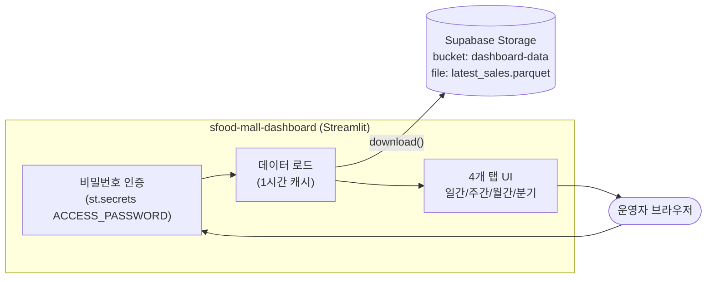
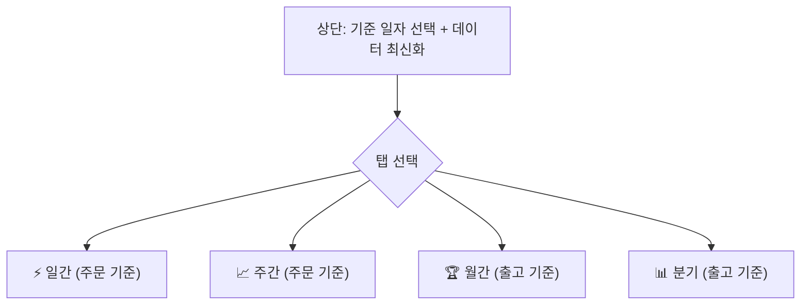
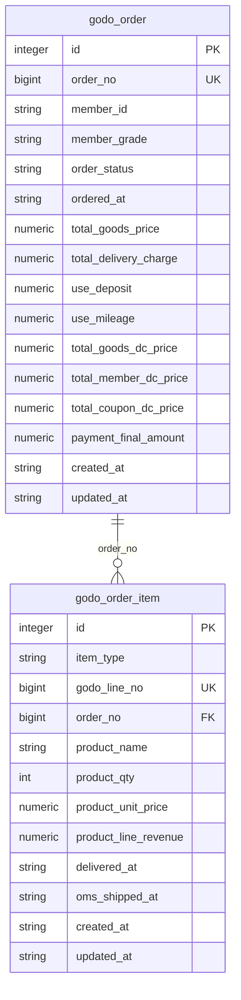
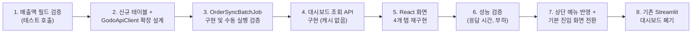

# 에쓰푸드몰 판매 대시보드 (sfood-mall-dashboard) 현황 분석

> 작성일: 2026-09-03
> 대상: `sfood-mall-dashboard/` (Streamlit 기반 별도 서비스)
> 목적: 메인 서비스(SFOOD-MALL-AUTOMATION, backend/frontend)로 통합하기 위한 사전 조사 문서

---

## 1. 개요

`sfood-mall-dashboard`는 에쓰푸드몰의 매출/주문 데이터를 조회하는 **독립 실행형 Streamlit 앱**입니다. 메인 서비스(backend: Java/Spring Boot, frontend: React)와는 별도 저장소·별도 배포 단위로 운영되고 있으며, 코드는 `app.py` 단일 파일(약 1,436줄)로 구성되어 있습니다.

- 별도 비밀번호(Basic Auth 유사) 인증을 사용하며, 메인 서비스의 OTP(One-Time Password, 일회용 비밀번호) 인증 체계와 연동되어 있지 않습니다.
- 데이터 소스가 Supabase Storage이며, 메인 서비스의 SQLite/PostgreSQL DB와 무관한 별도 파이프라인 산출물(Parquet 파일)을 사용합니다.
- 코드 자체에 리팩토링 필요 항목이 다수 식별되어 있으며, 별도 계획 문서(`sfood-mall-dashboard/docs/260406_리팩토링 계획.md`)로 정리되어 있습니다.

### 확인하지 못한 사항 (제약)

`sfood-mall-dashboard/CLAUDE.md`에 다음 규칙이 명시되어 있어 이번 조사에서 `.streamlit` 폴더(시크릿/설정 파일 추정)는 열람하지 않았습니다.

> "Never access the .streamlit folder directly. Extracting or importing its contents is strictly prohibited."

따라서 아래 항목은 **코드(`app.py`)에서 참조하는 키 이름만 확인**한 것이며, 실제 값(Supabase URL/Key, 접속 비밀번호)은 확인·기록하지 않았습니다.

- `st.secrets["ACCESS_PASSWORD"]`
- `st.secrets["supabase"]["url"]`, `st.secrets["supabase"]["key"]`

통합 작업 시 이 값들은 담당자에게 별도로 확인받아야 합니다.

---

## 2. 기술 스택

| 구분 | 내용 |
|---|---|
| 프레임워크 | Streamlit 1.56.0 (Python) |
| 데이터 처리 | pandas, numpy |
| 시각화 | Plotly (plotly.express, plotly.graph_objects) |
| 데이터 소스 연동 | supabase-py (Storage API) |
| 날짜 처리 | python-dateutil, pandas.tseries.offsets |
| 인증 | Streamlit `st.secrets` 기반 단일 비밀번호 폼 인증 |
| 실행 방식 | `streamlit run app.py` (별도 프로세스, 별도 포트) |

메인 서비스 스택과 비교:

| 영역 | 메인 서비스 | 대시보드 |
|---|---|---|
| Backend | Java 21, Spring Boot 3.5, JPA, SQLite/PostgreSQL | 없음 (Streamlit이 백엔드 역할 겸함) |
| Frontend | React 19, TypeScript, Vite | Streamlit 서버 사이드 렌더링 |
| 인증 | 이메일 OTP + 세션 | 고정 비밀번호 1개 |
| 데이터 저장소 | SQLite(dev)/PostgreSQL(운영) | Supabase Storage의 Parquet 파일 |

---

## 3. 아키텍처

### 3.1 현재 구조 (독립 서비스)



- `latest_sales.parquet` 파일은 대시보드 코드 밖의 **별도 배치/파이프라인이 생성**하는 것으로 추정되며, 이번 조사 범위(`sfood-mall-dashboard` 폴더)에는 해당 파이프라인 코드가 없습니다. 데이터 생성 주체(고도몰 원본 추출 → 가공 → Supabase 업로드 과정)는 별도 확인이 필요합니다.
- 데이터는 `@st.cache_data(ttl=3600)`로 1시간 캐시되며, 화면의 "데이터 최신화" 버튼으로 캐시를 강제 초기화할 수 있습니다.

### 3.2 메인 서비스와의 관계 (현재는 연결 없음)

메인 서비스 frontend에는 `VITE_DASHBOARD_URL` 환경 변수가 존재하지만(`frontend/src/hooks/useTeamsNotification.ts`), 이는 **상품/회원 관리 화면(GoodsPage) 자체를 가리키는 값**이며 이 문서의 대상인 Streamlit 판매 대시보드와는 무관합니다. 통합 시 "대시보드"라는 용어가 두 가지 의미로 이미 쓰이고 있다는 점에 주의가 필요합니다.

- 메인 서비스 내부 용어: "대시보드" = 상품 관리 화면 상단 요약 카드(SummaryCards)
- 이 문서의 "대시보드" = Streamlit 매출 분석 도구

---

## 4. 인증 및 보안

- `st.secrets`에 `ACCESS_PASSWORD`가 설정된 경우에만 로그인 폼이 노출됩니다(설정이 없으면 인증 없이 바로 접근 가능한 구조).
- 인증은 세션 상태(`st.session_state["authenticated"]`) 기반이며, 브라우저 새로고침 시 유지되지 않을 수 있습니다(Streamlit 세션 특성).
- 사용자 구분(개인별 로그인, 권한 등급)이 없고 "접속 가능/불가능"의 단일 레벨입니다.
- 메인 서비스는 이메일 OTP + 세션 기반 개인 인증 체계를 사용하므로, 통합 시 인증 방식을 어느 쪽에 맞출지 결정이 필요합니다.

---

## 5. 데이터 구조

대시보드는 Supabase에서 내려받은 단일 Parquet 파일(`df`)을 원본으로 사용합니다. 코드에서 참조하는 주요 컬럼은 다음과 같습니다(스키마 정의 파일은 이번 조사 범위에 없어 코드 사용 패턴 기준으로 역추적한 목록입니다).

| 컬럼명 | 추정 타입 | 용도 |
|---|---|---|
| `주문 번호` | string/int | 주문 단위 식별자 (dedup 기준) |
| `주문일자` | datetime | 일간/주간 탭 필터 기준 |
| `배송일자` | datetime | 연간 추이 필터 기준(`df_year_delivery`) |
| `OMS출고일` | datetime (파생, = 배송일자 + 1일) | 월간/분기 탭 필터 기준 |
| `결제_final` | 숫자 | 매출액 (VAT 제외 기준으로 표기됨) |
| `상품명` | string | 상품 식별, "선물" 포함 상품은 로드 시 제외 |
| `상품수량` | 숫자 | 주문 내 상품 수량 |
| `상품별 단순 총매출` | 숫자 | 상품 단위 매출 집계용 |
| `회원등급명_요약` | string | 고객 등급 세그먼트 (파이/라인 차트 그룹 기준) |
| `구분자_비회원포함` | string/int | 고객 고유 식별자 (비회원 포함, 주문자 수 집계 기준) |

### 데이터 로드 시 적용되는 필터

- `df = df[~df['상품명'].str.contains('선물')]` — "선물" 문구가 포함된 상품 전체를 매출 집계에서 제외합니다.
- "잠봉 슬라이스 500g/400g" (단, "한정" 문구 제외) 품목은 4개 탭 모두에서 "잠봉 슬라이스 (3종 총합)"이라는 별도 롤업(합산) 행으로 재구성됩니다. 특정 상품군에 대한 하드코딩된 비즈니스 로직입니다.

### 미확인 사항

- 위 컬럼들의 원천(고도몰/OMS/WMS 중 어디에서 왔는지), NULL 허용 여부, 정확한 타입은 실제 Parquet 스키마 또는 파이프라인 코드 확인이 필요합니다.
- `구분자_비회원포함`이 세션/기기 단위인지 회원 CI(고유식별정보) 단위인지 등 식별자의 정확한 정의는 문서화되어 있지 않습니다(대시보드 자체 리팩토링 계획 문서에서도 같은 의문이 제기되어 있음).

---

## 6. 기능 명세 (탭별)

화면은 상단 공통 영역(제목, 기준 일자 선택, 데이터 최신화 버튼)과 4개 탭으로 구성됩니다.



주문 기준(일간/주간)과 출고 기준(월간/분기)이 서로 다른 날짜 컬럼을 사용한다는 점이 핵심 특징입니다.

### 6.1 공통 지표 정의

| 지표 | 설명 | 계산식 |
|---|---|---|
| 총 매출 (VAT-) | 부가세 제외 매출 합계 | `결제_final` 합계 (주문 단위 dedup) |
| 총 주문 건수 | 유니크 주문 번호 수 | `주문 번호`.nunique() |
| 총 주문자 수 | 유니크 구매자 수 | `구분자_비회원포함`.nunique() |
| 총 주문 빈도 | 1인당 평균 주문 횟수 | 주문 건수 / 주문자 수 |
| 주문당 평균 구매 SKU | 주문 1건당 평균 상품 종류 수 | 주문별 `상품명` nunique 평균 |
| 주문당 평균 구매 수량 | 주문 1건당 평균 총 수량 | 주문별 `상품수량` 합계 평균 |
| 객단가 (AOV, Average Order Value) | 주문 1건당 평균 매출 | 총 매출 / 총 주문 건수 |
| 결제자당 평균 매출 (ARPPU, Average Revenue Per Paying User) | 구매자 1인당 평균 매출 | 총 매출 / 총 주문자 수 (월간/분기에만 표시) |

### 6.2 일간 탭

- 조회 기준: `주문일자` = 선택한 기준 일자(기본값: 어제)
- 핵심 지표 카드 7개(매출/주문건수/주문자수/주문빈도/평균SKU/평균수량/AOV)
- 시간대별(0~23시) 매출 추이 영역 차트
- 회원 등급별 매출 비중 도넛 차트
- 등급별 상세 지표 테이블 (합계 행 포함)
- 일간 인기 품목 Top 6 가로 막대 차트 + 잠봉 슬라이스 전용 차트
- 최근 20일 매출/주문건수 콤보 차트(막대+라인), 기준 요일 하이라이트

### 6.3 주간 탭

- 조회 기준: 이번 주 월요일 ~ 기준 일자
- 일간 탭과 동일한 지표 세트(7개 카드) + 동일 구성의 차트/테이블
- 최근 5주 매출/주문 추이 콤보 차트 추가

### 6.4 월간 탭

- 조회 기준: 사용자가 드롭다운에서 월(YYYY-MM) 선택, 필터는 `OMS출고일`(= 배송일자 + 1일) 기준
- 핵심 지표 카드 8개(ARPPU 추가)
- 일별 출고 매출/주문 추이 콤보 차트
- 등급별 상세 지표(AOV/ARPPU 포함), 인기 품목 Top 6, 잠봉 슬라이스 차트
- 일별 실적 상세 테이블 (`st.fragment`로 구현된 조회 항목 전환형 — 매출액/주문건수/주문자수)
- **전년 동월 비교**: 매출·주문건수, 구매자수·AOV 각각 콤보 차트 2개
- 최근 2개년 월별 추이 차트
- 월별 실적 상세 테이블 (조회 항목: 매출액/주문건수/주문자수/건당수량/건당SKU/AOV/ARPPU, 선택 시 등급별 라인 차트 연동)

### 6.5 분기 탭

- 조회 기준: 사용자가 드롭다운에서 분기(YYYY-QQ) 선택, 필터는 `OMS출고일` 기준
- 월간 탭과 동일한 구성(핵심 지표 8개, 분기 내 월별 추이, 등급별 상세, 인기 품목, 월별 실적 상세)
- **전년 동분기 비교** 차트 2개
- 최근 8분기 추이 차트
- 분기별 실적 상세 테이블 (7개 조회 항목, 등급별 라인 차트 연동)

---

## 7. 코드 구조

```text
app.py (~1,436줄)
├── [L1~11]     imports
├── [L13~60]    페이지 설정 및 공통 UI 함수 (gray_memo)
├── [L62~92]    비밀번호 인증
├── [L94~123]   데이터 로드 (Supabase Storage → Parquet → DataFrame, 1시간 캐시)
├── [L128~332]  공통 함수
│               - plot_combo_chart: 막대+라인 콤보 차트
│               - plot_horizontal_bar: 가로 막대 차트
│               - add_details_summary_row / _bold_last_row / _fmt / get_style_format: 테이블 포맷 유틸
│               - render_monthly_detail / render_yearly_detail / render_q_monthly_detail / render_q_trend_detail:
│                 @st.fragment로 분리된 상세 테이블+차트 렌더러 4종
├── [L338~360]  상단 공통 UI (기준 일자 선택, 탭 정의)
├── [L366~560]  Tab 1: 일간 분석
├── [L562~757]  Tab 2: 주간 분석
├── [L758~1128] Tab 3: 월간 분석
└── [L1129~1436] Tab 4: 분기 분석
```

핵심 함수 요약:

| 함수 | 역할 |
|---|---|
| `init_connection()` | Supabase 클라이언트 생성 (`@st.cache_resource`) |
| `load_parquet_data()` | Supabase Storage에서 Parquet 다운로드 후 DataFrame 변환 (`@st.cache_data(ttl=3600)`) |
| `plot_combo_chart()` | 막대(좌축)+라인(우축) 콤보 차트 생성 (여러 탭에서 재사용) |
| `plot_horizontal_bar()` | 인기 품목용 가로 막대 차트 (정의되어 있으나 실제 호출부는 각 탭에서 `px.bar`를 직접 호출하는 방식과 혼재) |
| `render_*_detail()` 4종 | `st.segmented_control` + `st.dataframe` 조합으로 조회 항목을 전환하는 상세 테이블 렌더러 |

### 7.1 알려진 코드 이슈 (자체 리팩토링 계획 기준 요약)

`sfood-mall-dashboard/docs/260406_리팩토링 계획.md`에 정리된 항목 중 통합 작업에 영향을 줄 수 있는 것만 요약합니다.

- 주간/월간 탭에는 빈 데이터에 대한 가드(`if df.empty`)가 없어 데이터가 없는 기간 조회 시 `ZeroDivisionError` 등 예외가 발생할 수 있음(일간/분기 탭에는 있음).
- 등급별 집계 로직, 잠봉 슬라이스 롤업 로직, YoY(전년 동기 대비, Year over Year) 차트 스타일 로직이 탭별로 거의 동일하게 4회 반복되어 있음(공통 함수화 미적용).
- 날짜 필터 방식이 일간 탭(문자열 비교)과 나머지 탭(`dt.normalize().between()`)에서 다르게 구현되어 있음.
- 매직 스트링/숫자(기준 시작일 `2025-01-01`, 요일 배열 등)가 여러 곳에 분산되어 있음.
- 신규/재구매 고객 구분 지표는 아직 없음(데이터에 최초 구매일 식별 컬럼이 있는지 사전 확인 필요 상태로 남아 있음).

이 항목들은 "대시보드 자체의 코드 품질" 이슈이며, 통합 여부와 무관하게 존재합니다. 통합 과정에서 로직을 이식할 경우 이 반복/미검증 구간을 그대로 옮기지 않도록 주의가 필요합니다.

---

## 8. 메인 서비스 통합 시 검토가 필요한 지점

이 섹션은 사실 정리가 아니라 통합 착수 전 확인이 필요한 논점을 나열한 것입니다(구현 방향은 아직 결정되지 않음).

1. **런타임 통합 방식**: Streamlit(Python) 앱을 React/Spring Boot 스택 안으로 어떻게 들여올지 방향이 여러 가지입니다.
   - (a) Streamlit 앱을 그대로 두고 iframe/링크로 메인 프론트엔드에서 연결
   - (b) 대시보드의 집계 로직을 Spring Boot API로 재구현하고 프론트엔드(React)에서 새 화면으로 재작성
   - (c) 두 방식을 단계적으로 병행 (1단계 링크 연결 → 2단계 네이티브 재구현)
2. **인증 통합**: 현재 단일 비밀번호 인증을 메인 서비스의 OTP+세션 인증으로 대체할지, 별도 접근 제어를 유지할지 결정 필요.
3. **데이터 소스 통합**: Supabase Storage의 Parquet 파일이 유일한 데이터 소스인데, 이 파일을 만드는 파이프라인(원본: 고도몰/OMS로 추정)이 이번 조사 범위 밖에 있어 별도 확인이 필요합니다. 메인 서비스 DB(SQLite/PostgreSQL)로 데이터 소스를 일원화할지, Supabase 연동을 그대로 유지할지 결정 필요.
4. **용어 충돌**: 메인 서비스 프론트엔드에 이미 "대시보드"라는 이름의 화면(상품 요약 카드)이 있으므로, 통합 시 화면/메뉴 명칭 구분이 필요합니다.
5. **비즈니스 로직 재검증**: "선물 상품 제외", "잠봉 슬라이스 3종 롤업" 같은 하드코딩된 특정 상품 로직이 여전히 유효한 기준인지 현업 확인이 필요합니다.
6. **비밀정보 이관**: `ACCESS_PASSWORD`, Supabase URL/Key 등은 `.streamlit/secrets.toml`류 파일에 있을 것으로 추정되며(직접 열람 안 함), 이관 시 메인 서비스의 환경 변수 방식(`DB_PATH`, `GODO_*` 등과 동일한 패턴)으로 옮기는 작업이 필요합니다.

---

## 9. 통합 방향성 (확정)

아래는 논의를 거쳐 확정된 방향입니다. 8번 섹션의 논점 중 (1) 런타임 통합 방식, (2) 인증 통합, (3) 데이터 소스 통합, (4) 용어 충돌은 아래와 같이 결론이 났습니다.

| 논점 | 결론 |
|---|---|
| 런타임 통합 방식 | Streamlit을 React로 **완전 재구현**한다(화면·기능 동일 목표, 단 시각 스타일은 100% 동일이 아니라 "기능적으로 충분한 대체" 수준이면 허용 — 9.1 차트 라이브러리 결정 참고). iframe/링크 방식은 채택하지 않는다. |
| 화면 진입 위치 | 메인 서비스 상단 메뉴에 **"대시보드"** 항목을 신설한다. 로그인 후 기본 진입 화면을 대시보드로 바꾼다(현재는 상품 관리 화면이 기본). |
| 인증 | 별도 비밀번호 인증을 폐기하고, 메인 서비스의 이메일 OTP 세션 인증에 통합한다. |
| 데이터 소스 | Supabase Storage/Parquet 방식을 폐기한다. **메인 서비스 배치가 고도몰 주문 조회 API를 호출해 메인 DB에 신규 테이블로 적재**하고, 조회 API는 그 테이블을 **캐시 없이 직접 쿼리**한다. |
| 용어 충돌 | 메인 서비스 프론트엔드의 기존 "대시보드"(GoodsPage 상단 요약 카드 영역)는 명칭을 변경하거나 이번 신규 메뉴와 구분되는 이름으로 조정이 필요하다(예: 기존 요약 카드 영역은 "요약" 등으로 명칭 변경). 세부 명칭은 화면 설계 단계에서 확정한다. |

이 결정에 따라 원래 8번 섹션에서 열려 있던 항목들은 아래 9.1~9.7에서 더 구체적인 설계 논점으로 재분석합니다.

### 9.1 프론트엔드 재구현 범위

- 4개 탭(일간/주간/월간/분기)의 지표 카드, 콤보 차트(막대+라인), 도넛 차트, 가로 막대 차트(인기 품목), 등급별 상세 테이블(합계 행 포함), `segmented_control` 방식의 조회 항목 전환형 상세 테이블, 전년 동기 비교 차트, 등급별 라인 차트까지 **6번(기능 명세) 문서에 정리한 항목 전부**가 재구현 범위입니다.
- **차트 라이브러리 결정: Chart.js (`react-chartjs-2`)**. 현재 frontend `package.json`에는 차트 라이브러리가 없어(`plotly.js`, `recharts`, `visx`, `chart.js` 등 미설치) 신규 의존성 추가가 필요합니다(`frontend/CLAUDE.md`상 "명시적 요청 없이 라이브러리 추가 금지" 규칙 적용 대상이지만, 이번 통합 작업 범위 내 필수 의존성으로 승인됨). Chart.js는 믹스 차트(막대+라인)와 이중 y축, `interaction mode: 'index'` 기반 통합 툴팁을 기본 지원해 원본 Plotly 콤보 차트를 충분히 대체할 수 있습니다. **원본과 100% 동일한 스타일(그라데이션, 커스텀 hovertemplate 등)까지는 요구하지 않으며, 기능적으로 충분히 대체되는 수준이면 문제로 보지 않기로 결정**했습니다(9.1 재구현 목표를 "완전 동일"에서 "기능적으로 충분한 대체"로 조정).
- 잠봉 슬라이스 롤업, "선물" 상품 제외처럼 특정 상품명에 하드코딩된 로직은 프론트가 아닌 **백엔드 집계 단계**로 옮기는 것이 자연스럽습니다(현재 Streamlit은 화면 코드에 비즈니스 로직이 섞여 있음 — 재구현 시 개선 지점).
- 라우팅: `App.tsx`에 `/dashboard` 라우트를 추가하고, 루트(`/`) 및 로그인 후 리다이렉트 기본값을 `/dashboard`로 변경합니다. 기존 `/goods`, `/members`는 유지됩니다.

### 9.2 백엔드 — 신규 도메인 모듈

기존 Clean Architecture 컨벤션(`auth`, `goods`, `batch`, `wms`, `common`)을 따라 신규 도메인 모듈(가칭 `sales` 또는 `dashboard`)을 추가하는 방향이 자연스럽습니다.

```text
com.sfood.automation.sales (가칭)
├── presentation   ← 대시보드 조회 API (일간/주간/월간/분기별 집계 응답)
├── application    ← 조회 UseCase (기간별 집계 쿼리 조합)
├── domain         ← 집계 모델, Repository Port
└── infrastructure
    ├── external   ← 고도몰 주문 조회 API 클라이언트 (신규)
    └── persistence← 주문 스냅샷 테이블 JPA 구현체 (신규)
```

- 고도몰 주문 조회 연동은 기존 `GodoApiClient`/`GodoTransport`/`GodoApiProperties` 패턴(공용 `partner_key`+`key` 폼 인증, `GodoTransport`를 통한 HTTP 호출, `ApiTransactionLogRepository`를 통한 호출 로그 적재)을 그대로 재사용할 수 있습니다. 즉, **신규 API 키 발급 없이 기존 `GODO_PARTNER_KEY`/`GODO_KEY` 자격 증명으로 주문 조회 엔드포인트만 추가 연동**하는 구조입니다.
- 배치는 기존 `BatchJobType` enum(`PRODUCT_SYNC`, `MEMBER_SYNC`)에 `ORDER_SYNC`(가칭)를 추가하고, `ProductSyncBatchJob`/`MemberSyncBatchJob`과 동일한 패턴으로 `OrderSyncBatchJob`을 신설해 기존 배치 스케줄 관리 화면(`BatchScheduleAdminController`)에서 그대로 등록·수동 실행·이력 조회가 가능하도록 합니다. 별도의 배치 실행 체계를 새로 만들 필요가 없습니다.

#### 9.2.1 고도몰 주문 조회 API 스펙 확인 완료

`sfood-mall-dashboard/docs/godomall5-order-search-api.md`(고도몰5 오픈API 스펙서 v1.0, 2025-06-16, 4.1절 원문 기준)가 저장소에 업로드되어 스펙을 확인했습니다. 8번/9.2절에서 "미확인"으로 남겨두었던 엔드포인트·파라미터·페이지네이션·응답 스키마가 아래와 같이 확정됩니다.

| 항목 | 내용 |
|---|---|
| 엔드포인트 | `POST https://openhub.godo.co.kr/godomall5/order/Order_Search.php` (기존 `GodoApiClient`와 동일한 base-url 하위 경로, `goods` → `order`만 교체) |
| 인증 | 기존 상품 API와 동일하게 `partner_key` + `key` 폼 파라미터 방식 → `GodoTransport`/`GodoApiProperties` 재사용 가능 |
| 조회 조건 | `orderNo` 단건 조회 **또는** `startDate`+`endDate`(기간, `dateType=order`\|`modify`) 조회. 둘 중 하나 조합이 필수 |
| 페이지네이션 | Offset이 아닌 **커서 방식**. `size`(페이지당 건수) 지정 시, 응답 `lastOrder`가 있으면 다음 요청에 이전 응답의 마지막 `orderNo`를 `lastOrder`로 실어 보내면 그보다 작은 주문번호를 이어서 조회. 정렬 기본값은 주문번호 내림차순 |
| 응답 구조 | `order_data` 배열 = **주문 헤더 단위**. 각 주문 안에 `orderGoodsData`(주문상품, 배열) / `addGoodsData`(추가상품) / `orderInfoData`(배송지) / `orderDeliveryData`(배송비) / `claimData`(클레임) 등이 중첩. 대시보드가 필요로 하는 "주문×상품 라인" 단위 데이터는 `order_data[].orderGoodsData[]`를 펼쳐서(flatten) 구성해야 함 |

**리스크로 지목했던 사항 — 실제 응답 샘플로 1차 검증**: 응답 스키마 원문에는 필드별로 "사용불가" 표시가 붙어 있어 `settlePrice`(총 주문금액), `taxSupplyPrice`/`taxVatPrice`(과세금액/부가세) 등 매출액 직결 필드를 못 쓸 수 있다는 우려가 있었습니다. 실제 운영 데이터로 받은 응답 샘플(`sfood-mall-dashboard/docs/ORDER_SAMPLE.xml`, 주문 1건)을 확인한 결과:

- `settlePrice`, `taxSupplyPrice`, `taxVatPrice`, `realTaxSupplyPrice`, `realTaxVatPrice`, `totalGoodsPrice`, `totalDeliveryCharge` **모두 실제 값이 채워져서 응답**되었습니다. 스펙 문서의 "사용불가" 표기는 실제로는 "값이 비어 있다"는 뜻이 아니라 "정확성을 보장하지 않는다/문의 시 지원 대상이 아니다" 정도의 의미로 보입니다. → 매출액 산출이 API 응답만으로 불가능하다는 우려는 **1차적으로는 해소**되었습니다.
- 다만 검증 샘플이 **1건**뿐이고, 이 주문은 네이버페이 채널·비회원(`memNo=0`) 주문입니다. 결제수단(카드/무통장/간편결제)이나 회원/비회원 여부에 따라 필드 채움 패턴이 달라질 수 있으므로, 다양한 채널·상태의 주문 샘플을 추가로 확보해 `settlePrice` 등의 값이 Streamlit 버전의 `결제_final`(VAT 제외 실결제금액)과 일치하는 산식인지 별도 대조 검증이 필요합니다(9.6에 반영).

**신규로 발견된 리스크 — PG 채널 주문의 대용량 중복 데이터 blob**: 확인된 주문의 `orderGoodsData.checkoutData` 필드에는 네이버페이 자체 주문/배송/클레임 정보를 JSON 문자열로 통째로 담은 대용량 blob이 들어 있습니다. 여기엔 주문자명·연락처·배송지·**클레임 상세 사유(고객이 남긴 실제 불만 텍스트 포함)** 등 API 상위 필드와 중복되거나 더 상세한 개인정보/민원 내용이 그대로 들어 있습니다. 이런 필드는 신규 테이블에 **원문 그대로 저장하지 않아야** 하며(9.3의 PII 최소화 원칙과 연결), 저장 대상 필드를 화이트리스트 방식으로 명시적으로 골라내는 설계가 필요합니다.

**추가 확인된 사항**:
- `orderGoodsData[].deliveryDt`는 "발송(출고) 처리 시각"으로 보이고, 배송 완료 시각은 별도 필드 `deliveryCompleteDt`로 분리되어 있습니다.
- 샘플 주문은 클레임(교환 신청 후 반려) 이력이 있는 주문이었습니다.
- 비회원 주문에서는 `memGroupNm`(회원 그룹명)이 빈 값이었습니다.

#### 9.2.2 리스크 정리 및 결정 사항 (1차)

위에서 드러난 4가지 리스크에 대해 1차로 아래와 같이 방향을 잡았습니다(이후 9.2.3에서 원본 파이프라인 코드 확보로 3, 4번을 포함한 다수 항목이 사실로 확정됨).

| # | 리스크 | 1차 결정/진행 방향 |
|---|---|---|
| 1 | PG 채널 주문의 `checkoutData` 등 대용량 중복 blob(개인정보·클레임 텍스트 포함) | 신규 테이블에는 **애초에 저장하지 않는다**(화이트리스트 방식) |
| 2 | 배송일자가 `deliveryDt`(발송)/`deliveryCompleteDt`(완료) 중 무엇인지 애매함 | (1차 추정) 배송일자 = 주문일자+1일로 파생 계산 — **9.2.3에서 부정확했음이 확인되어 정정** |
| 3 | `회원등급명_요약` ↔ `memGroupNm` 매핑 일치 여부 | 회원 주문 샘플로 확인 예정 |
| 4 | 클레임/취소·환불 등 특정 `orderStatus` 주문을 매출 집계에 포함할지 여부 | 원본 파이프라인의 수집 기준 확인 필요 |

#### 9.2.3 원본 데이터 파이프라인(`update_data.py`) 확인 — 리스크 2/3/4 및 매출액 산식 전부 확정

`sfood-mall-dashboard/update_data.py`(Supabase의 `latest_sales.parquet`을 매일 생성/갱신하는 원본 배치 스크립트)가 저장소에 업로드되어 전체 로직을 확인했습니다. 지금까지 추정으로 남겨두었던 항목 대부분이 **코드로 확정**됩니다.

**① 매출액(`결제_final`) 산식 — 완전히 확정.** `settlePrice`를 그대로 쓰는 것이 아니라, 사용 가능 필드만 조합해 직접 계산하고 있었습니다.

```python
결제_final = (
    총 품목 금액(totalGoodsPrice) + 총 배송 금액(totalDeliveryCharge)
    - 사용된 총 예치금(useDeposit) - 사용된 총 마일리지(useMileage)
    - 총 상품 할인 금액(totalGoodsDcPrice) - 총 회원 할인 금액(totalMemberDcPrice)
    - 총 쿠폰 할인 금액(totalCouponGoodsDcPrice + totalCouponOrderDcPrice + totalCouponDeliveryDcPrice)
) * (10 / 11)
```

마지막에 `× 10/11`을 곱하는 것은 부가세 10% 포함 금액을 **부가세 제외 금액으로 환산**하는 처리입니다. 즉 9.2.1에서 "사용불가"로 우려했던 `settlePrice`/`taxVatPrice` 계열 필드는 실제로 하나도 쓰지 않고, `totalGoodsPrice`/`totalDeliveryCharge`(사용 가능 필드)와 할인·마일리지·예치금 사용액만으로 계산합니다. 신규 백엔드 구현 시 이 산식을 그대로 이식하면 됩니다.

**② 배송일자 정의 — 9.2.2의 1차 추정을 정정.** 실제로는 **API 값을 그대로 사용**하고 있었습니다.

- `배송일자` = `orderGoodsData[].deliveryDt` (원본 API 필드 값, 파생 계산 아님)
- `OMS출고일` = `배송일자 + 1일` (이 파생 계산은 대시보드 화면 코드 `app.py`에 있던 것이 맞음)

즉 지난 턴에서 "배송일자 = 주문일자+1일"로 정리했던 결정은 **부정확했습니다.** 정확한 체인은 `deliveryDt`(API) → `배송일자` → `+1일` → `OMS출고일` 입니다. 9.3 테이블에 정정 반영했습니다. 참고로 날짜 파싱 시 `"0000-00-00 00:00:00"` 같은 미배송 상태 값은 결측(NaT)으로 치환되므로, 아직 출고 전 주문은 `배송일자`/`OMS출고일`이 비어 있을 수 있습니다.

**③ `회원등급명_요약` 매핑 — 확정.** `회원등급명`은 API의 `memGroupNm`을 그대로 가져오고, 빈 값(비회원)은 `"비회원"`으로 치환합니다. 이후 등급명에 `"사업자"`가 포함되면 `"사업자회원"`으로 뭉치고, 그 외에는 원래 등급명을 그대로 씁니다.

```python
회원등급명 = memGroupNm (빈 값 → "비회원")
회원등급명_요약 = "사업자회원" if "사업자" in 회원등급명 else 회원등급명
```

**④ `orderStatus` 필터(매출 집계 대상) — 확정.** 화이트리스트 방식이며, 아래 상태만 수집 대상입니다(그 외 상태, 즉 취소/반품/환불 등으로 추정되는 코드는 자동으로 제외됨).

| 코드 | 의미 | 코드 | 의미 |
|---|---|---|---|
| `o1` | 입금대기 | `f2` | 고객결제중단 |
| `p1` | 결제완료 | `f4` | PG 확인요망 |
| `g1` | 상품준비중 | `s1` | 구매확정 |
| `d1` | 배송중 | `e1` | 교환접수 |
| `d2` | 배송완료 | `e5` | 교환완료 |

(스크립트에는 이전 버전에서 쓰던 더 넓은 상태 목록이 주석으로 남아 있어, 운영 중 의도적으로 위 10개로 축소된 것으로 보입니다. 지난번 확인한 `ORDER_SAMPLE.xml`의 주문 상태 `s1`(구매확정)이 이 목록에 포함되어 있어, 교환 신청 이력이 있어도 최종 상태가 `s1`/`e1`/`e5`면 매출에 포함된다는 뜻입니다.)

**⑤ 구매자 식별자 정의 — 회원 기준으로 확정(비회원 처리는 논의 대상 아님).**

원본 파이프라인은 비회원 주문까지 포함해 "회원명_전화번호" 조합으로 식별자를 만들었지만(`구분자_비회원포함`), **수집 대상 주문 자체가 회원 기반**이라는 결정에 따라 신규 설계에서는 비회원 식별 로직을 도입하지 않습니다. 구매자 식별자는 `memId`(회원 아이디) 하나로 단순화하며, 이에 따라 원본 파이프라인에 있던 PII(고객명+전화번호 원문 조합) 저장 문제도 자연스럽게 발생하지 않습니다.

**⑥ 배치 설계에 참고할 추가 패턴**

- **재수집(refresh) 방식으로 상태 변경을 반영**: `dateType=modify`를 쓰는 것이 아니라, 매 실행마다 **최근 21일치를 `dateType=order`로 통째로 재조회**해서 상태가 바뀐 주문(예: 입금대기→배송완료, 또는 이전엔 제외 상태였다가 포함 상태로 바뀐 주문)을 반영합니다. 21일보다 오래된 데이터는 재검증하지 않고 그대로 둡니다. → 9.4의 "modify 기준 보정 배치가 별도로 필요하다"는 추정은 **불필요**했던 것으로 확인되어, 대신 "최근 N일 롤링 재조회" 패턴을 채택하면 됩니다.
- **머지 방식**: 재조회 결과가 있으면 `주문일자 < cutoff`인 기존 데이터만 남기고, 그 뒤에 재조회 결과 + 어제자 신규 수집분을 (`주문 번호`+`상품명`) 키 기준으로 upsert. 동일 주문에 동일 상품명이 두 줄 이상 있는 경우 구분이 안 되는 한계가 있으나, 원본 파이프라인도 이 한계를 그대로 가지고 있었습니다. 신규 설계에서는 PK를 `order_no + order_line_seq`(9.3 초안)로 잡아 이 한계를 자연스럽게 해소할 수 있습니다.
- **추가상품(`addGoodsData`) — 결정: 포함**: 원본 파이프라인은 `orderGoodsData`(주문상품)만 파싱하고 `addGoodsData`는 다루지 않았습니다. 다만 이것이 "의도적으로 제외한다"는 비즈니스 규칙이 있었던 게 아니라 단순히 원본 구현 범위 밖이었던 것으로 보이므로, **명시적 제외 근거가 없으면 포함한다**는 원칙에 따라 신규 설계에서는 `addGoodsData`도 함께 수집합니다(9.3.3에 `item_type` 컬럼으로 반영).
- API 호출은 회당 1회(재조회 21일 구간 전체를 `size` 지정 없이 한 번에 요청)로 되어 있어, 응답 건수가 많아지는 시점(주문량 증가)에 페이지네이션(`size`+`lastOrder`)이 필요해질 수 있습니다. 신규 배치는 처음부터 페이지네이션을 포함해 구현하는 것을 권장합니다.

### 9.3 데이터 저장 설계 — 신규 테이블 (확정)

#### 9.3.1 단일 테이블이 아닌 헤더+라인 2개 테이블로 정규화

Streamlit 대시보드가 쓰던 `latest_sales.parquet`은 **주문-상품 라인 단위**로 평평하게(flat) 저장된 데이터입니다. 그런데 9.2.3에서 확인한 것처럼 `payment_final_amount`(결제_final), `member_grade`(회원등급), `order_status`(주문상태)는 전부 **주문 헤더 단위 값**이라, 라인 단위 1테이블에 그대로 넣으면 상품이 여러 개인 주문은 같은 헤더값이 라인 수만큼 중복 저장됩니다. 원본 Streamlit도 이 중복 때문에 매출을 집계할 때마다 매번 `drop_duplicates(subset=['주문 번호'])`를 먼저 거쳐야 했습니다(`app.py` 전 탭 공통 패턴).

신규 설계에서는 이 구조적 중복과 "매번 dedup" 부담을 없애기 위해 **주문 헤더 테이블(`godo_order`) + 주문상품 라인 테이블(`godo_order_item`) 2개로 정규화**합니다. 네이밍은 기존 코드베이스의 고도몰 연동 테이블 명명 규칙(`godo_member`, `godo_member_business` 등 `godo_` 접두사)을 따랐습니다.



#### 9.3.2 `godo_order` (주문 헤더)

| 컬럼 | 타입 | 제약 | 매핑/산식 | 비고 |
|---|---|---|---|---|
| `id` | INTEGER | PK, IDENTITY | (신규 surrogate key) | 기존 엔티티 관례(`GoodsEntity`, `GodoMemberEntity` 등)와 동일하게 자연키 대신 surrogate PK 사용 |
| `order_no` | BIGINT | NOT NULL, UNIQUE | `order_data[].orderNo` | 조회/조인 키. 응답 정렬 기준이자 페이지네이션 커서(`lastOrder`)이기도 함 |
| `member_id` | VARCHAR | NOT NULL | `order_data[].memId` | 회원 기준으로 한정(9.6 확정) — NULL 불가 |
| `member_grade` | VARCHAR | NOT NULL | `order_data[].memGroupNm` (원본값 그대로 저장) | "사업자회원 통합" 같은 요약 로직은 **저장하지 않고 조회 쿼리에서 계산**(아래 9.3.4 참고) — 요약 규칙이 바뀌어도 재적재가 필요 없도록 |
| `order_status` | VARCHAR(2) | NOT NULL | `order_data[].orderStatus` | 9.2.3④의 10개 화이트리스트 코드만 저장됨(그 외는 배치가 건너뜀) |
| `ordered_at` | TEXT(SQLite) / VARCHAR(50)(PostgreSQL) | NOT NULL | `order_data[].orderDate` | 일간/주간 탭 필터 기준. **(정정, 아래 "날짜 타입 결정" 참고)** 기존 코드베이스의 날짜 저장 관례(문자열 + 애플리케이션 파싱)를 그대로 따름 |
| `total_goods_price` | NUMERIC | NOT NULL | `totalGoodsPrice` | `payment_final_amount` 산식 구성요소, 감사·재계산용으로 원본값 보존 |
| `total_delivery_charge` | NUMERIC | NOT NULL | `totalDeliveryCharge` | 〃 |
| `use_deposit` | NUMERIC | NOT NULL | `useDeposit` | 〃 |
| `use_mileage` | NUMERIC | NOT NULL | `useMileage` | 〃 |
| `total_goods_dc_price` | NUMERIC | NOT NULL | `totalGoodsDcPrice` | 〃 |
| `total_member_dc_price` | NUMERIC | NOT NULL | `totalMemberDcPrice` | 〃 |
| `total_coupon_dc_price` | NUMERIC | NOT NULL | `totalCouponGoodsDcPrice + totalCouponOrderDcPrice + totalCouponDeliveryDcPrice` (배치에서 미리 합산) | 원본 파이프라인의 "총 쿠폰 할인 금액" 통합과 동일 |
| `payment_final_amount` | NUMERIC | NOT NULL | 9.2.3①의 확정 산식 결과 | 매 조회마다 재계산하지 않도록 배치 적재 시점에 미리 계산해 저장(캐시 목적 — "조회는 캐시 없이"라는 요구는 애플리케이션 조회 캐시를 말하는 것이지, 이 컬럼은 저장된 사실값) |
| `created_at` / `updated_at` | TEXT/VARCHAR(50) | NOT NULL | (배치 관리용) | 21일 롤링 재수집으로 값이 갱신될 때마다 `updated_at` 갱신 |

인덱스: `UNIQUE(order_no)`, `INDEX(ordered_at)`, `INDEX(member_grade)`.

#### 9.3.3 `godo_order_item` (주문상품 라인)

| 컬럼 | 타입 | 제약 | 매핑/산식 | 비고 |
|---|---|---|---|---|
| `id` | INTEGER | PK, IDENTITY | (신규 surrogate key) | |
| `item_type` | VARCHAR(10) | NOT NULL | `'GOODS'`(주문상품) 또는 `'ADD_GOODS'`(추가상품) | **(결정, 신규)** 원본은 `orderGoodsData`(주문상품)만 수집했지만, 제외할 명시적 근거가 없어 `addGoodsData`(추가상품)도 함께 수집하기로 결정. 두 응답 배열은 필드 구성이 거의 동일해 같은 테이블에 담고 구분자만 둠 |
| `godo_line_no` | BIGINT | NOT NULL | `orderGoodsData[].sno`("주문상품 고유번호") 또는 `addGoodsData[].sno`("주문 추가상품 고유번호") | 두 배열의 `sno`는 서로 다른 채번 체계라 값이 겹칠 수 있음 — 단독 UNIQUE 대신 `(item_type, godo_line_no)` 복합 UNIQUE로 둠 |
| `order_no` | BIGINT | NOT NULL, FK → `godo_order.order_no` | `orderGoodsData[].orderNo` / `addGoodsData[].orderNo` | |
| `product_name` | VARCHAR | NOT NULL | `goodsNm` | "선물"/"잠봉 슬라이스" 특수 처리 대상 |
| `product_qty` | INT | NOT NULL | `goodsCnt` | |
| `product_unit_price` | NUMERIC | NOT NULL | `goodsPrice` | |
| `product_line_revenue` | NUMERIC | NOT NULL | `goodsPrice × goodsCnt`(9.2.3 확정) | 원본의 "상품별 단순 총매출"과 동일 |
| `delivered_at` | TEXT/VARCHAR(50) | NULL 허용 | `deliveryDt`(API 값 그대로) | 미출고 주문은 `"0000-00-00 00:00:00"` → NULL 처리 |
| `oms_shipped_at` | DATE | NULL 허용 | `delivered_at + 1일`(파생) | `delivered_at`이 NULL이면 함께 NULL. 월간/분기 탭 필터·그룹핑은 일(day) 단위만 쓰므로 시각 정보 없는 `DATE`로 저장 |
| `created_at` / `updated_at` | TEXT/VARCHAR(50) | NOT NULL | (배치 관리용) | |

인덱스: `UNIQUE(item_type, godo_line_no)`, `INDEX(order_no)`(조인용), `INDEX(delivered_at)`, `INDEX(oms_shipped_at)`, `INDEX(product_name)`(인기 품목/잠봉·선물 패턴 매칭용).

#### 9.3.4 조회 시 반드시 지켜야 할 패턴 — 매출액은 "주문 단위로 한 번만" 합산

일간/주간 탭은 `godo_order.ordered_at`으로 먼저 필터링하면 되므로 단순합니다. 하지만 **월간/분기 탭은 `godo_order_item.oms_shipped_at`(라인 단위 컬럼)으로 필터링**해야 하는데, 매출액(`payment_final_amount`)은 헤더 테이블에 있는 값입니다. 원본 Streamlit 로직과 동일한 결과를 내려면 다음 순서를 지켜야 합니다.

1. `godo_order_item`에서 `oms_shipped_at`이 기간 내인 **주문번호(`order_no`) 집합**을 먼저 구한다(`SELECT DISTINCT order_no ...`).
2. 그 주문번호 집합으로 `godo_order`를 조회해 `payment_final_amount`를 **주문당 1회만** 합산한다.

이렇게 해야 원본 Streamlit이 하던 "라인 단위로 기간 필터 → 주문번호로 dedup → 헤더 매출 합산" 동작을 그대로 재현합니다. 참고로 이 방식은 **한 주문의 상품들이 서로 다른 달에 걸쳐 출고되면, 그 주문 전체 매출이 두 달 모두에 중복 카운트될 수 있다**는 원본의 특성도 그대로 물려받습니다 — **(결정) 이는 새로 생긴 문제가 아니라 원본 대시보드가 이미 갖고 있던 특성이므로, 신규 구현에서도 수정하지 않고 동일하게 유지합니다.**

회원등급 "사업자회원" 요약은 조회 쿼리에서 다음과 같이 계산합니다(원본 로직 9.2.3③과 동일한 결과):

```sql
CASE WHEN member_grade LIKE '%사업자%' THEN '사업자회원' ELSE member_grade END
```

수집 범위는 **회원 주문으로 한정**합니다(9.6 확정). `memId`가 없는 비회원 주문은 배치 적재 단계에서 제외하며, 신규 설계에서는 비회원 식별·PII 조합 로직을 아예 두지 않습니다.

개인정보 최소화 관점에서, `orderInfoData`(주문자/수취인 이름·전화번호·주소)나 `orderConsultData`(상담메모), `checkoutData` 등 대시보드 집계에 쓰이지 않는 PII/blob 필드는 위 두 테이블 어디에도 **저장하지 않습니다**(9.2.2 리스크 1, 조직 보안 기준상 불필요한 개인정보 보관 금지).

**날짜 타입 결정 (정정)**: 처음에는 날짜 범위 집계가 핵심 기능이라는 이유로 `TIMESTAMP`/`DATE` 네이티브 타입을 쓰기로 했었으나, 실제 구현 단계에서 확인해보니 이 프로젝트는 **로컬 개발은 SQLite, 운영은 PostgreSQL(AWS RDS)** 을 쓰고 두 환경 모두에서 검증 가능해야 합니다. 이미 코드베이스 전체가 날짜/시각 컬럼을 `TEXT`(SQLite)/`VARCHAR`(PostgreSQL) 문자열로 저장하고 `SqliteInstantParser` 같은 애플리케이션 레벨 파서로 다루는 검증된 패턴을 쓰고 있어(모든 기존 엔티티가 이 방식), 신규 테이블만 네이티브 타입을 쓰면 두 DB 간 동작 차이나 예상치 못한 매핑 문제가 생길 위험이 있습니다. 따라서 **기존 관례를 그대로 따라 `ordered_at`/`delivered_at`/`oms_shipped_at`/`created_at`/`updated_at` 모두 문자열(TEXT/VARCHAR) 컬럼으로 저장**하도록 정정했습니다. 실제 스키마는 `backend/src/main/resources/schema.sql`(SQLite)과 `backend/src/main/resources/postgresql/schema-order-postgresql.sql`(PostgreSQL)에 반영되어 있습니다.

### 9.4 데이터 적재 범위

화면에서 실제로 조회하는 최대 기간을 기준으로 최소 적재 범위를 역산하면 다음과 같습니다.

- 일간 탭 "최근 20일 추이" → 최소 20일
- 주간 탭 "최근 5주 추이" → 최소 5주(약 35일)
- 월간 탭 "최근 2개년 추이" + "전년 동월 비교" → 최소 24개월(2년)
- 분기 탭 "최근 8분기 추이" + "전년 동분기 비교" → 최소 8분기(2년)

즉, **화면이 요구하는 최대 조회 범위는 "최근 2년"**입니다.

**2년치 과거 데이터 확보 방식 — 결정**: 별도의 일회성 마이그레이션 스크립트가 아니라, **기간을 지정해 수동으로 실행 가능한 수집 기능**을 만들어서 그 기능으로 2년치를 모으는 방향으로 진행합니다. 즉:

1. **일 단위 증분 배치(자동, 매일)**: 기존 `BatchJobType`(`PRODUCT_SYNC`, `MEMBER_SYNC`)과 동일한 패턴의 `ORDER_SYNC` 배치. `dateType=order`, `startDate=endDate=전일자`로 매일 자동 실행 + 최근 21일 롤링 재조회(9.2.3⑥).
2. **기간 지정 수집 기능(수동, 재사용 가능)**: 담당자가 시작일~종료일을 지정해 수동으로 실행할 수 있는 별도 기능(관리자 화면 또는 배치 관리 화면에 파라미터 추가). 이 기능으로 "작년 이맘때~올해" 같은 임의 구간을 여러 번 나눠 실행해 2년치를 채워 넣습니다. 최초 백필뿐 아니라, 나중에 특정 기간 데이터를 다시 채워야 할 때도 동일 기능을 재사용할 수 있어 일회성 스크립트보다 유지보수에 유리합니다.
3. **보관 주기 — 결정**: 삭제하지 않고 무기한 누적한다. 2년은 화면이 요구하는 "최소 조회 범위"일 뿐, 데이터 자체를 2년 후 삭제할 필요는 없음.

9.2.1/9.2.3에서 확인한 스펙과 원본 파이프라인 기준으로 위 방향을 다음과 같이 구체화합니다.

- **일 단위 증분 적재**는 API 파라미터와 잘 맞습니다. `dateType=order`, `startDate=endDate=전일자`로 호출하고 `size`+`lastOrder` 커서로 전량 페이지네이션하면 됩니다.
- **상태 변경 반영(확정, 9.2.3⑥)**: 별도의 `dateType=modify` 보정 배치는 필요 없습니다. 원본 파이프라인이 쓰던 **"최근 21일 롤링 재조회"** 패턴을 그대로 채택합니다 — 매일 배치 실행 시 `dateType=order`로 최근 21일 구간을 통째로 재조회해서 그 기간 내 상태가 바뀐 주문(입금대기→배송완료, 또는 제외 상태→포함 상태 등)을 갱신하고, 21일보다 오래된 데이터는 재검증하지 않습니다. 21일이라는 창 크기 자체는 그대로 가져올지, 다르게 조정할지는 운영 중 결정 가능한 값이라 필수 확인 항목은 아닙니다.
- **기간 지정 수집 기능**은 내부적으로 위 일 단위 배치와 같은 API 호출 로직(`Order_Search.php` + `size`/`lastOrder` 페이지네이션)을 재사용하되, 날짜 범위를 파라미터로 받습니다. 스펙 원문에 기간 범위 제한이 명시되어 있지 않으므로, 한 번에 `startDate=2년 전`, `endDate=오늘`로 요청 가능한지, 아니면 응답 지연·타임아웃 방지를 위해 **일자/월자 단위로 구간을 나눠(chunking) 순차 호출**해야 하는지는 실제 호출 테스트로 확인이 필요합니다. 담당자가 수동으로 여러 번 나눠 실행하는 전제이므로, 1회 호출 범위(예: "한 달씩")를 화면/파라미터에서 제한해두면 안전합니다.
- 재시도/중단 후 재개를 고려하면, 배치 실행 로그에 "마지막으로 성공 처리한 날짜 구간(또는 `lastOrder` 커서)"을 기록해두는 것이 안전합니다(기존 `BatchExecutionLog` 모델 확장 여지).

### 9.5 성능(속도) 고려사항

- **운영 DB 확정: PostgreSQL (AWS RDS)**. 로컬/개발 환경은 SQLite를 쓰지만(`application-local.yml`), 운영은 `application-prod.yml`에 설정된 AWS RDS PostgreSQL 인스턴스를 사용합니다. SQLite의 동시 쓰기·대용량 집계 제약을 걱정할 필요는 없고, PostgreSQL 기준으로 인덱스·쿼리 설계를 하면 됩니다.
- **커넥션 풀 재판단 — 문제 없음으로 결론**: 실사용자가 **2~5명 수준**이라는 것을 감안하면, `application-prod.yml`의 HikariCP `maximum-pool-size: 5`는 지금도 충분합니다. 우려했던 지점은 대시보드 화면 하나가 여러 차트/테이블을 동시에 여러 API 호출로 채우는 구조라 "사용자 수"보다 "화면당 동시 호출 수"가 더 중요한 변수라는 것이었는데, 5명이 동시에 대시보드를 열어도 각 요청은 매우 짧게 끝나는 단순 조회(SELECT)라 커넥션을 오래 붙잡지 않습니다. 따라서 **현재 풀 크기를 그대로 두고, 실제 운영 후 커넥션 대기가 관찰되면 그때 늘리는 방향**으로 결정합니다. 다만 대시보드 화면이 탭 전환 시 3~5개 API를 동시에 쏘는 구조라면(6.장 화면 구성상 가능성 있음), 프론트에서 무분별하게 병렬 호출을 늘리지 않도록(필요한 탭만 지연 로딩) 설계하는 것을 권장합니다.
- **성능 목표치 — 결정**: 구체적인 응답 시간 기준(P95 등)을 미리 정하지 않고, 실제 구현·운영하면서 문제가 보이면 그때 조정합니다. **로컬(SQLite) 환경에서는 성능을 아예 따지지 않습니다** — 로컬은 어차피 운영 DB(PostgreSQL)와 다르고 데이터 볼륨도 작아서, 로컬에서의 느림/빠름은 운영 성능 판단 근거로 삼지 않습니다. 로컬 검증의 목적은 어디까지나 "쿼리/스키마가 두 DB에서 동일하게 정상 동작하는지" 기능 확인이지 성능 확인이 아닙니다.
- 캐시를 사용하지 않는다는 방향이 확정되어 있으므로, 성능은 전적으로 (a) 테이블 인덱스 설계, (b) 집계 쿼리 최적화(N+1 방지, 필요한 경우 DB 뷰 활용), (c) 페이지 단위 지표만 필요 시점에 조회(탭 전환 시 지연 로딩)에 의존하게 됩니다. 목표치를 미리 정하진 않지만, 인덱스는 9.3.2/9.3.3에 정의된 것을 기본으로 가져갑니다.

### 9.6 열려 있는 질문 (착수 전 확인 필요)

이번 심화 분석에서도 실제 착수를 위해 사용자/현업 확인이 필요한 항목이 남아 있습니다.

**원본 파이프라인(`update_data.py`) 확인으로 해결된 항목:**

1. ~~고도몰 주문 조회 오픈 API의 정확한 스펙~~ → **확인 완료** (9.2.1).
2. ~~매출액(`결제_final`) 산식~~ → **확인 완료** (9.2.3①). `settlePrice`가 아니라 `totalGoodsPrice`+`totalDeliveryCharge`-할인·마일리지·예치금, ×10/11 산식.
3. ~~PG 채널 blob(`checkoutData`) 저장 여부~~ → **결정 완료**: 저장하지 않음(9.2.2 리스크 1).
4. ~~배송일자 정의~~ → **확인 완료, 이전 결정 정정** (9.2.3②). `orderGoodsData[].deliveryDt` API 값을 그대로 사용(파생 계산 아님). `OMS출고일 = 배송일자+1일`만 파생.
5. ~~`회원등급명_요약` ↔ `memGroupNm` 매핑~~ → **확인 완료** (9.2.3③). "사업자" 포함 시 "사업자회원"으로 통합, 그 외 원문 유지.
6. ~~`orderStatus` 필터 기준~~ → **확인 완료** (9.2.3④). `o1/p1/g1/d1/d2/f2/f4/s1/e1/e5` 10개 코드만 화이트리스트로 수집.
7. ~~구매자 식별자 정의~~ → **결정 완료**: 수집 대상 주문 자체를 **회원 기반으로 한정**하기로 하여, `buyer_key`는 `memId`로 단순화. 비회원 식별(원본의 "회원명_전화번호" 조합, PII 리스크 포함)은 논의 대상에서 제외(9.2.3⑤, 9.3).
8. ~~상태 변경(취소/배송완료 등) 반영 방식~~ → **확인 완료** (9.2.3⑥). `dateType=modify` 불필요, 최근 21일 롤링 재조회로 대체.
9. ~~신규 테이블 구조~~ → **확정 완료** (9.3). `godo_order`(헤더) + `godo_order_item`(라인) 2테이블 정규화, 컬럼/타입/인덱스까지 정의.
10. ~~날짜 컬럼 타입~~ → **결정 완료 (정정)**: 로컬 SQLite/운영 PostgreSQL 양쪽 호환을 위해, 처음 정했던 `TIMESTAMP`/`DATE` 대신 기존 코드베이스 관례인 TEXT/VARCHAR 문자열로 최종 확정(9.3.2/9.3.3). 스키마 구현 완료(`backend/src/main/resources/schema.sql`, `postgresql/schema-order-postgresql.sql`).
11. ~~월간/분기 매출 중복 집계 특성 유지 여부~~ → **결정 완료**: 원본 대시보드가 이미 갖고 있던 특성이므로 수정하지 않고 동일하게 유지(9.3.4).
12. ~~운영 환경 DB 종류~~ → **확인 완료**: PostgreSQL(AWS RDS). 로컬/개발은 SQLite, 운영은 `application-prod.yml`의 RDS PostgreSQL(9.5).

**여전히 열려 있는 질문:**

13. ~~RDS 커넥션 풀 적정성~~ → **재판단 완료**: 사용자 2~5명 규모라 현재 `maximum-pool-size: 5` 그대로 유지, 문제 시 사후 조정(9.5).
14. ~~성능 목표치/데이터 볼륨 사전 확인~~ → **결정 완료**: 지금 수치를 미리 정하지 않고, 실제 구현·운영 진행하면서 필요 시 조정한다(로컬 SQLite도 성능은 따지지 않음, 9.5).
15. ~~데이터 보관/삭제 정책~~ → **결정 완료**: 삭제하지 않고 무기한 누적(9.4).
16. ~~"선물 상품 제외", "잠봉 슬라이스 3종 롤업" 하드코딩 로직 유지 여부~~ → **결정 완료**: 신규 구현에서도 그대로 유지(8번 섹션 5항).
17. ~~프론트엔드 차트 라이브러리 선정~~ → **결정 완료**: Chart.js(`react-chartjs-2`). 원본과 100% 동일한 스타일은 요구하지 않고, 기능적으로 충분히 대체되면 허용(9.1).
18. ~~기존 GoodsPage의 "대시보드" 명칭 충돌~~ → **결정 완료**: 신규 메뉴가 "대시보드"를 쓰므로, 품목(GoodsPage) 쪽에서 충돌하는 명칭은 변경한다. 실제 코드 검색 결과 UI 문구로 "대시보드"가 노출되는 곳은 `frontend/src/api/teams.ts`의 Teams 알림 버튼 문구 `"대시보드 바로가기"`(품목 관리 화면 링크) 1곳이며, `VITE_DASHBOARD_URL` 환경 변수명과 `frontend/docs/` 하위 여러 기획 문서에도 품목 화면을 "대시보드"로 지칭한 서술이 다수 있음. 새 명칭 확정과 실제 반영(환경 변수명 포함 여부, 문서 일괄 정정)은 프론트엔드 구현 단계 작업으로 별도 진행.
19. ~~2년치 과거 데이터 확보 방식~~ → **접근 방식 결정 완료**: 일회성 스크립트가 아니라 "기간 지정 수동 수집 기능"으로 구현(9.4). 다만 고도몰 API의 실제 기간 제한/응답 지연 여부는 실제 호출 테스트로 확인 필요 — chunking 단위(일/월)는 그 결과에 따라 결정.
20. ~~추가상품(`addGoodsData`) 포함 여부~~ → **결정 완료**: 명시적 제외 근거가 없어 포함(9.2.3⑥, 9.3.3 `item_type` 컬럼).

### 9.7 단계적 실행 순서 제안



이 순서는 제안이며, 실제 계획 문서(`spec.md`/`plan.md`)는 9.6의 미확인 사항이 정리된 이후 별도로 작성하는 것을 권장합니다.

---

## 10. 참고 자료

- 분석 대상 코드: `sfood-mall-dashboard/app.py`
- 대시보드 자체 리팩토링 계획: `sfood-mall-dashboard/docs/260406_리팩토링 계획.md`
- 대시보드 작업 제약: `sfood-mall-dashboard/CLAUDE.md`
- 고도몰5 주문조회 API 스펙: `sfood-mall-dashboard/docs/godomall5-order-search-api.md` (원본: `godomall5_openAPI_spec_v1.0_20250616` 4.1절, GitHub `main` 브랜치에 업로드된 파일을 로컬에 반영)
- 고도몰 주문조회 API 실제 응답 샘플(주문 1건, PII 일부 마스킹): `sfood-mall-dashboard/docs/ORDER_SAMPLE.xml` (GitHub `main` 브랜치에 업로드된 파일을 로컬에 반영)
- 원본 데이터 파이프라인(Supabase `latest_sales.parquet` 생성/갱신 배치): `sfood-mall-dashboard/update_data.py` (GitHub `main` 브랜치에 업로드된 파일을 로컬에 반영)
- 메인 서비스 개요: `README.md`
- 메인 서비스 Frontend 아키텍처: `frontend/docs/product/architectures.md`
- 메인 서비스 Backend 아키텍처: `backend/docs/product/architectures.md`
- **[구현 완료]** 신규 테이블 스키마: `backend/src/main/resources/schema.sql`(SQLite, `godo_order`/`godo_order_item`), `backend/src/main/resources/postgresql/schema-order-postgresql.sql`(PostgreSQL, 신규 파일)
- **[구현 완료]** 배치 잡 등록(비활성): `backend/src/main/resources/data.sql` / `postgresql/data-postgresql.sql`(`order-sync`, `enabled=0`), `backend/src/main/java/.../batch/domain/enums/BatchJobType.java`(`ORDER_SYNC`)
- 관련 태스크 문서: `backend/docs/tasks/dashboard-order-schema/`(spec/plan/tasks/test-result/result)
