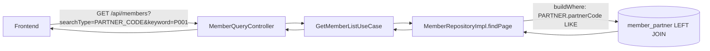

# 회원 목록 조회 API — 파트너 검색 조건 추가 설계

- 작성일: 2026-06-22
- 브랜치: `feature/member-list-partner-search`
- 대상 API: `GET /api/members` (회원 관리 목록 조회)

## 1. Overview

회원 관리 목록 조회 API의 검색 조건에 `partner_code`(파트너 코드)와
`partner_name`(파트너명) LIKE 검색을 추가한다. 기존 `searchType` 드롭다운 방식을
그대로 재사용하여 두 검색 타입(`PARTNER_CODE`, `PARTNER_NAME`)을 신규로 추가한다.

## 2. Background

프론트엔드에서 사용자가 파트너 데이터를 업데이트한 뒤, 해당 파트너 코드/이름으로
회원 목록을 재조회해야 하는 요구가 있다. 현재 `partnerCode`/`partnerName`은
LEFT JOIN으로 응답에는 포함되지만 검색 조건으로는 사용할 수 없다.

## 3. 결정 사항

| 항목 | 결정 |
|---|---|
| 통합 방식 | 기존 `searchType` enum에 `PARTNER_CODE`, `PARTNER_NAME` 추가 |
| 동시 검색 | 각 타입 단독 검색 (코드·이름 OR 통합 없음) |
| 검색 연산 | `LIKE '%keyword%'` (QueryDSL `.contains()`) |

## 4. 조회 흐름

## 5. 변경 범위

| 파일 | 변경 |
|---|---|
| `MemberSearchCondition.java` | `SearchType` enum에 `PARTNER_CODE`, `PARTNER_NAME` 추가 |
| `MemberRepositoryImpl.java` | `buildWhere` switch에 2개 case 추가 (`PARTNER.partnerCode/partnerName.contains`) |
| `backend/docs/product/api-spec-member.md` | searchType 허용값 문서 업데이트 |
| `frontend/docs/product/api-spec.md` | searchType 허용값 문서 업데이트 |

응답 DTO·정렬 키·프론트 응답 계약은 변경하지 않는다 (이미 partnerCode/partnerName 응답 포함).

## 6. 동작 명세

- 파트너 데이터가 없는 회원(LEFT JOIN NULL)은 LIKE에 매칭되지 않아 결과에서 제외됨 (의도된 동작).
- `partner_code`/`partner_name`은 평문 컬럼이므로 암호화/해시 불필요 (`mem_id`와 동일).
- keyword가 빈 값이면 `normalized()`가 null 처리하여 파트너 조건 없이 전체 조회.

## 7. Acceptance Criteria

- 파트너 코드 `P001` 보유 회원 존재 시 `searchType=PARTNER_CODE&keyword=P001` → 해당 회원 조회.
- 파트너명에 `홍길동` 포함 회원 존재 시 `searchType=PARTNER_NAME&keyword=홍길동` → LIKE 부분일치 조회.
- 매칭 파트너 없으면 빈 목록(totalElements=0) 반환.
